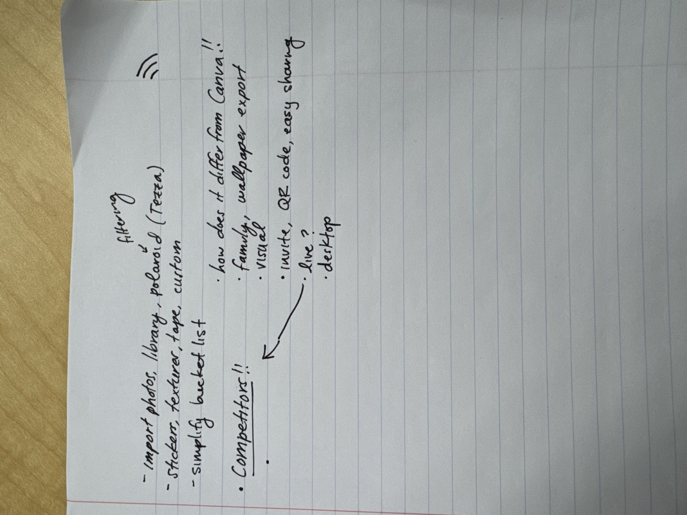

# 11/9 | Crit notes from Monday's class

Feedback on the bucket list and scrapbook idea.

## Typed up

**For the scrapbook pages**
- Import photos from your library
- Polaroid frames and photo filters, like Tezza
- Stickers, textures, tape, and custom stickers
- Simplify the bucket list

**Competitors!!**
- How does it differ from Canva!!
- Family, wallpaper export
- Visual
- Invite, QR code, easy sharing
- Live? (arrow to Competitors: what makes ours live when others aren't?)
- Desktop

## What we can do next
- **Show how we're different from Canva.** Canva is a design tool. Ours is a book the friend group fills in together, with the bucket list on page 1 and pages made live.
- **Make the scrapbook editor richer:** photo library import, polaroid frames, filters, tape, textures and custom stickers.
- **Make the bucket list simpler.**
- **Make it easy to join:** invite links and a QR code.
- **Look into** families as users, exporting a page as a phone wallpaper, and desktop as the main platform.
