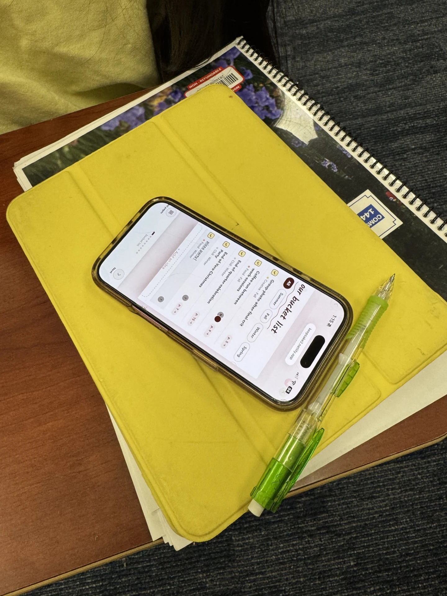
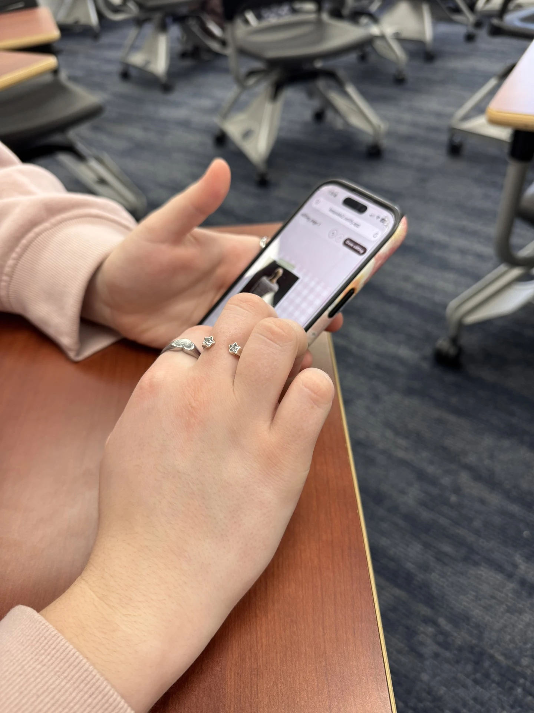

# 11/24 | Phone layout user testing

Tested the new phone layout on [keepsake2.netlify.app](https://keepsake2.netlify.app/) with 2 people on their phones.

## What happened

- They thought it was self-explanatory.
- They joined the book right away and started adding stickers and photos without being told how.
- Zooming in and out felt a little choppy.
- They thought it was really cool to see things move live and to see who's on the page.

## What to change

- Make pinch to zoom smoother.

