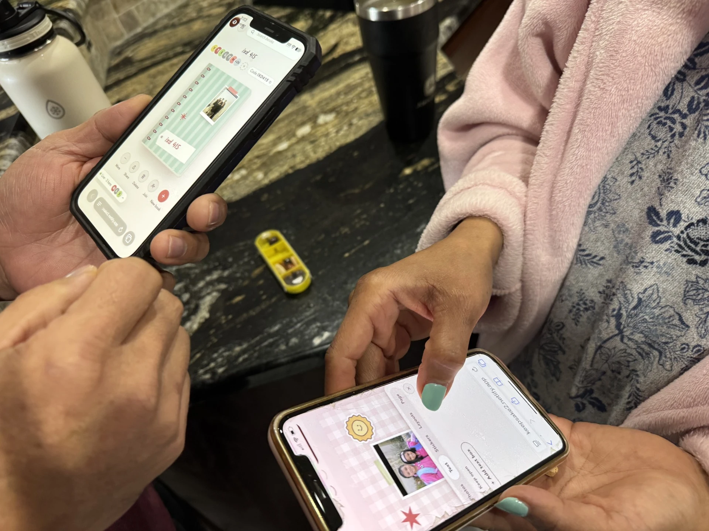

# Phone layout user testing

Testing the phone layout on [keepsake2.netlify.app](https://keepsake2.netlify.app/), 7 people in all.

## 11/24 | 2 people

Tested with 2 people on their phones.

### What happened

- They thought it was self-explanatory.
- They joined the book right away and started adding stickers and photos without being told how.
- Zooming in and out felt a little choppy.
- They thought it was really cool to see things move live and to see who's on the page.

### What to change

- Make pinch to zoom smoother.

## 11/26 | 5 people at Thanksgiving

Tested with 5 people on their phones at Thanksgiving.

### What happened

- Switching between the tool tabs (Photos, Text, Stickers, Layouts, Page) on a phone isn't very efficient.
- It isn't clear whether it saves, or that it saves automatically.
- When adding something, it wasn't clear whether to drag it or tap it.
- The pop-up sheet can't be dragged down, which makes it harder to use, and it feels too big.
- They wanted more font options and a way to make text bigger.

### What to change

- Make it quicker to switch between tools on a phone.
- Show that changes save automatically (for example, a small "Saved" message).
- Make it clear how to add things: tap to add, or drag onto the page.
- Let people drag the sheet down to close it, and make it shorter.
- More font choices, and an easier way to make text bigger.

