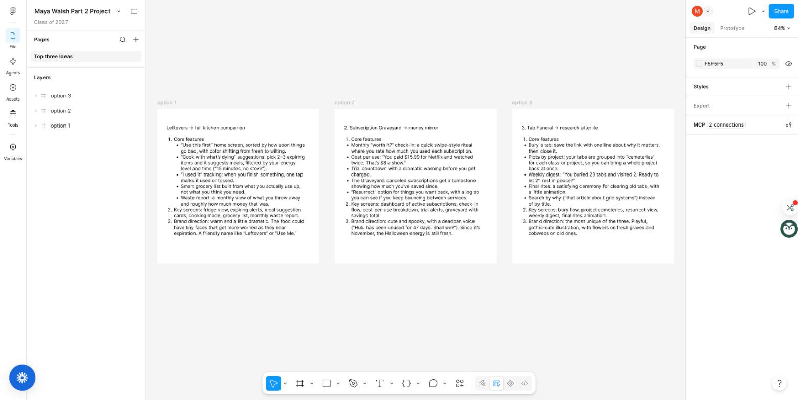
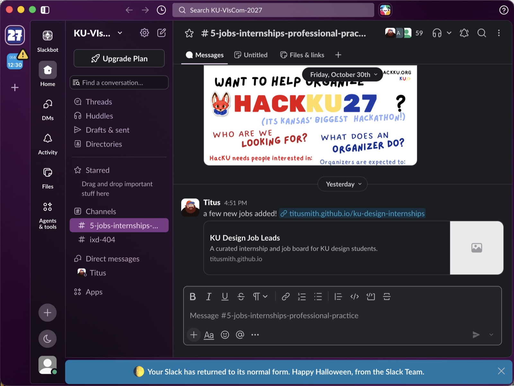
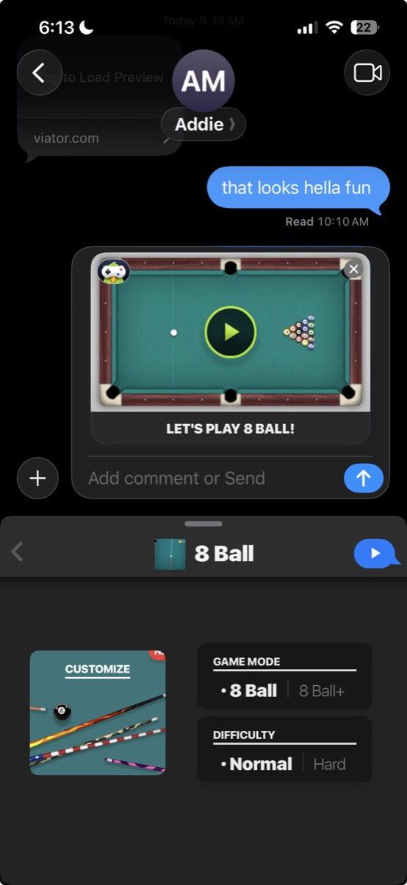

# Maya | 3 different multiplayer things!

# 1. Figma, a design tool where a whole team can work in the same file at the same time
*Signals that others are here*
- Live cursors with name tags. Each person gets a color and their name floats next to their cursor, so you see exactly where everyone is pointing in real time.
- Avatars in the top right corner. A row of faces or initials shows everyone currently in the file.
- Colored selection boxes. When someone selects an object, it gets outlined in their color, so you can tell what they're working on before they change it.
- Cursor chat. You can type a quick message that pops up right at your cursor, like talking out loud while pointing.

*Signals that others are watching*
- Spotlight and follow. Click someone's avatar to follow their view, or spotlight yourself so everyone follows you. You know you're being watched because your avatar shows who's following.
- Comments pinned to specific spots on the canvas, with names and timestamps.

# 2. Slack, a messaging app for teams with channels, threads and calls
*Signals that others are here*
- Presence dot. A green dot next to a name means active; a hollow dot means away.
- "[Name] is typing..." at the bottom of the channel, so you know a reply is coming.
- Huddles. A headphone icon and avatars show who's in a live audio call in a channel, and you can jump in.
- Custom status, an emoji plus text like "lunch", gives a little context about what someone's doing.

*Signals that others are watching*
- Emoji reactions with counts. Hover to see exactly who reacted. This is the main proof people read your message.
- Threads show a reply count and the tiny avatars of who replied.
- No read receipts in channels. Unlike iMessage, Slack doesn't tell you who has seen a message. You only know someone read it if they react or reply, so reactions basically fill the gap read receipts would.

# 3. GamePigeon, a set of free mini games you play inside iMessage
*Signals that others are here*
- The game lives inside the group chat. It shows up as a message bubble, so the game is the conversation. You don't download a separate app or make an account.
- Turn notifications. When the other person shoots, a new bubble appears, which means "they were here and it's your turn."
- iMessage's own signals around the game: the typing bubble ("...") when they trash talk, and "Delivered" or "Read" under messages.

*Signals that others are watching*
- Replayed shots. When you open their move, you watch their shot play out before you take yours.
- Read receipts (if turned on) show whether they've seen your move yet.

