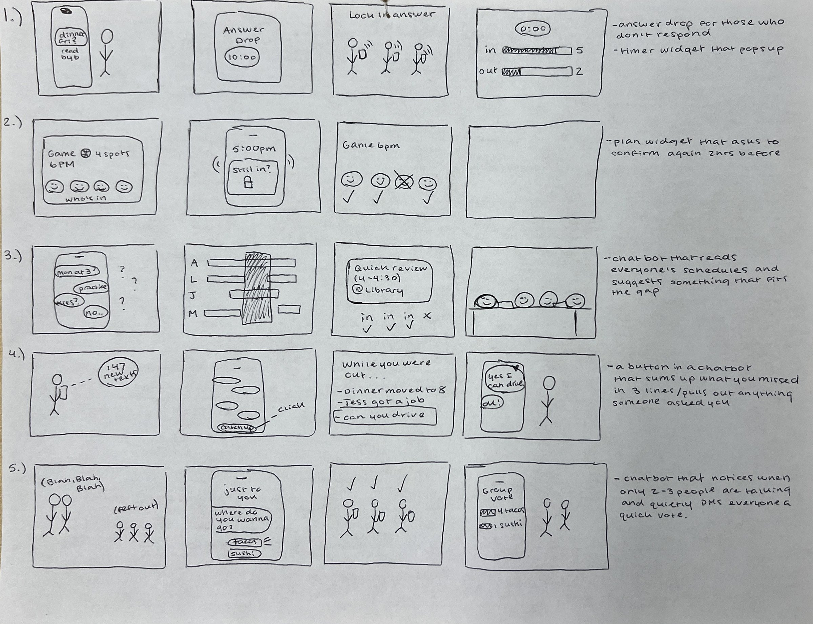
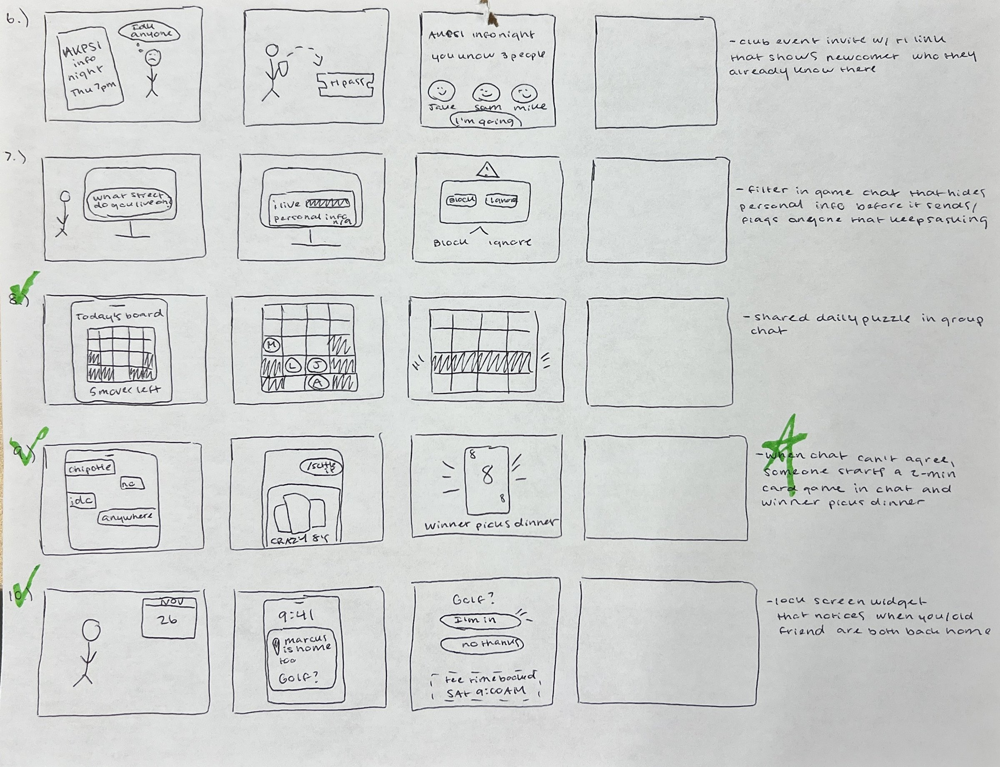

# 11/4 | Maya's 10 Storyboard Ideas

Each one is a 2–4 panel comic to draw in Sharpie and pin on the wall. Every idea has a software piece, but most of them aren't a standalone app. They live in the group chat, a widget, the lock screen, a game or a bot. All of them come from my interviews with Addie, Lanie and Anthony.

## My sketches

---

## 1. Answer Drop
**From:** Addie: people who read the text and don't reply "drive me crazy." She wants everyone replying "in the same time frame."
**Software:** an iMessage/GroupMe poll bubble with a countdown. Nobody's answer shows until the timer ends, so nobody waits to see what everyone else says first.
1. Addie texts "dinner Friday?" Under it: *Read by 6*. No replies. She's annoyed.
2. She sends an Answer Drop bubble with a 10:00 timer.
3. Friends' phones buzz: "Answer Drop closes in 10 min." Each one taps yes, no or maybe.
4. The timer hits 0:00 and all the answers flip over at once: "5 in, 1 out."

## 2. Lock It In
**From:** Addie, about people who say yes and don't show up. All 3 had plans fall through at the last minute.
**Software:** a plan card in the chat that asks everyone to re-confirm with one tap 2 hours before. If you don't tap, your spot goes to the next person on the waitlist.
1. A plan card in the chat: "Basketball game, 7pm. 4 spots." Four faces are on it.
2. At 5pm a lock screen alert says "Still in? Tap to lock it in."
3. One friend ignores it, and their face fades out of the card.
4. A waitlisted friend gets "A spot opened up!" and taps in. Four people show up.

## 3. The 30-Minute Plan
**From:** Lanie: a study session fell apart because the group "couldn't find more than 30 minutes" when everyone was free.
**Software:** a chat bot that reads everyone's calendar (class schedules, practice, shifts), finds the overlap, and suggests something that fits the time, even a short one.
1. Group chat: "when is everyone free??" followed by a mess of conflicting times.
2. Someone types "@findatime." Calendar bars stack up, and one small gap lights up: Tue 4:00–4:30.
3. The bot says "30 min works. Try: a quick review of chapters 3 and 4 at the library."
4. Four people at one table, a timer reads 0:30 and everyone's happy.

## 4. Catch Me Up
**From:** Lanie, who gets "five chats behind" when the group chat moves too fast.
**Software:** a button in the chat that sums up what you missed in 3 lines and pulls out anything someone asked you directly.
1. Lanie comes out of practice. Her phone says "147 new messages."
2. She taps "Catch me up."
3. A card: "Dinner moved to 8. Jess got the job. Someone asked if you can drive 👈"
4. Lanie replies once, "yes I can drive!" and she's caught up.

## 5. Pass the Mic
**From:** Anthony: in awkward chats, "communication is held between a few people" and the rest get left out.
**Software:** a group chat bot that notices when only 2–3 people are talking and quietly DMs everyone else a quick question. It posts the answers together, without names if people want.
1. A chat where two big speech bubbles talk over each other and three small faces sit at the edge.
2. A private DM to one of the quiet people: "Where do YOU want to go? (anonymous)"
3. The quiet people tap their picks.
4. The chat shows "Group vote: tacos 4, sushi 1." The two loud ones say "oh, ok, tacos."

## 6. Bring-a-Friend Pass
**From:** All 3 joined their groups through someone they already knew (Lanie's friend pulled her into soccer, Addie's roommates, Anthony's friend's boyfriend). Anthony wants to join AKPsi but isn't in any groups yet.
**Software:** a club event link with a "+1" invite. Before saying yes, the newcomer sees "You already know 3 people going."
1. Anthony sees an AKPsi flyer and thinks "I don't know anyone there."
2. A friend in the club texts him a +1 pass.
3. He opens it: "You know 3 people going" with 3 familiar faces.
4. Anthony walks in and gets waved over by people he knows.

## 7. Info Shield
**From:** Anthony was targeted in Roblox when he was 10–12 by someone who named his cousin's street. Addie ran into older men on Omegle and Fortnite. 2 of 3 had something unsafe happen online as minors.
**Software:** a filter built into game chat that catches personal info (addresses, school names, phone numbers) before it sends, and flags anyone who keeps asking for it.
1. A kid gaming. Chat from a stranger: "what street do u live on?"
2. The kid types his street. The message gets blocked: "🛡 Personal info hidden."
3. The stranger asks again. Their name turns red: "This player keeps asking for personal info. Block?"
4. The kid taps Block and keeps playing.

## 8. Group Puzzle
**From:** Anthony plays Block Blast alone and said "multiplayer would be pretty cool." Addie plays Candy Crush, Sudoku and crosswords. Casual games came up in all 3 interviews.
**Software:** one shared daily puzzle that lives in the group chat. Each person gets one move per day, and the group plays for a team score.
1. Morning: a puzzle bubble shows up in the group chat. "Today's board. 5 moves."
2. Between classes, each friend makes one move. Each one gets a small avatar on the board.
3. Anthony places the last piece. Lines clear. "Team score: 2,400 🔥"
4. Someone texts "ok we need a rematch IN PERSON." The game gets them talking.

## 9. Settle It
**From:** Addie loves iMessage Crazy Eights because "you can't cheat on it." Groups get stuck deciding things, and the loud people usually win.
**Software:** when a group chat can't agree, someone starts a 2-minute card game in the chat. Whoever wins picks the plan.
1. The chat goes in circles: "Chipotle." "No, Panda." "I don't care." "Anywhere."
2. Addie types "/settle it" and a Crazy Eights round opens in the chat.
3. Close-up of the final card: someone plays an 8. "WINNER picks dinner."
4. Everyone eating together. The winner looks smug and the losers laugh.

**Prototyped:** see the [Settle It prototype](settle-it-prototype/README.md) and [testing notes](settle-it-prototype/testing-notes.md).

## 10. Both Home
**From:** Anthony: with friends from home, "every time I see him it's like we've been talking for the past year." They don't need regular contact, just a chance to see each other.
**Software:** a lock screen widget that notices when you and an old friend are both back in your hometown at the same time (from shared calendars or location you choose to share), and suggests meeting up.
1. Anthony packing for Thanksgiving break.
2. Lock screen: "Marcus is home too, Nov 26–30. Golf?"
3. He taps "I'm in," and a tee time gets booked for both of them.
4. Two guys on a golf course: "Like we never left."

---

## Quick list for the wall

| # | Name | Interview | Where the software lives |
|---|---|---|---|
| 1 | Answer Drop | Addie | Poll bubble in the chat |
| 2 | Lock It In | Addie | Plan card + lock screen alert |
| 3 | The 30-Minute Plan | Lanie | Calendar bot in the chat |
| 4 | Catch Me Up | Lanie | Summary button in the chat |
| 5 | Pass the Mic | Anthony | Chat bot + private DMs |
| 6 | Bring-a-Friend Pass | All 3 | Event invite link |
| 7 | Info Shield | Anthony, Addie | Game chat filter |
| 8 | Group Puzzle | Anthony, Addie | Daily game in the chat |
| 9 | Settle It | Addie | Mini game in the chat |
| 10 | Both Home | Anthony | Lock screen widget |
