# 11/4 | Settle It prototype

Maya's prototype of storyboard concept **9. Settle It** (from [11/4 storyboard ideas](../maya-storyboard-ideas.md)).

**Open the prototype:** [http://localhost:3000](http://localhost:3000)
Start it first with `node server.js` in this folder (see [Run it](#run-it)). The link only works on the computer running the server. Phones on the same Wi-Fi use the address the terminal prints, like `http://192.168.x.x:3000`.

**The idea:** Addie loves iMessage games because "you can't cheat on it." Group chats get stuck deciding things, and the loudest person usually wins. In Settle It, anyone in the chat can start a quick mini game. Whoever wins picks the plan, and nobody gets to argue.

The storyboard used Crazy Eights. A full card game takes too long when people are hungry, so this prototype swaps it for two mini games that take under a minute:

| Game | How it works | What it tests |
|---|---|---|
| **Quick Draw** | The screen goes red, then green at a random moment. Fastest tap wins the round. First to 2 rounds wins. Tapping early loses you the round. | Does a skill game feel fair, or do people complain the fast person always wins? |
| **Lucky Draw** | Everyone flips one card from the same deck. High card wins (aces high, ties go by suit ♠ ♥ ♦ ♣). | Is pure luck more "un-arguable"? Is it fun enough? |
| **Surprise me** | The app picks one of the two. | Do people care which game it is? |

## The flow
1. Everyone joins one shared group chat on their own phone. It's designed to look and feel like iMessage.
2. The chat goes in circles ("chipotle" / "no panda" / "i dont care").
3. Someone taps **+** and opens the **Settle It** app from the drawer (like GamePigeon), or types `/settle it`. The Settle It sheet lets them set up the decision:
   - **Category:** Food, Movie, Plans, or Custom (type anything, like "who drives").
   - **On the table:** only the real options people mentioned for that category: restaurants and foods for Food, activities for Plans, movies for Movie (matched by `mentions.js`). The sheet opens on whatever the chat was last talking about. Remove any or add your own (up to 8). The winner picks from these.
   - **Game:** Quick Draw, Lucky Draw, or Surprise.
   - **Time to join:** 10, 15, or 30 seconds.
4. An iMessage-style app bubble shows up in the chat. Everyone has until the timer runs out to tap it and join. The starter can start early.
5. The game opens in a sheet that slides up over the chat on every phone at the same time.
6. The winner gets a "You pick dinner" screen with one-tap suggestions taken from the chat, or can type their own.
7. The winner's **SETTLED: Sushi** message lands in the chat "Sent with Confetti", and everyone sees the confetti.

## Prototype 1 screens

| | | |
|---|---|---|
| 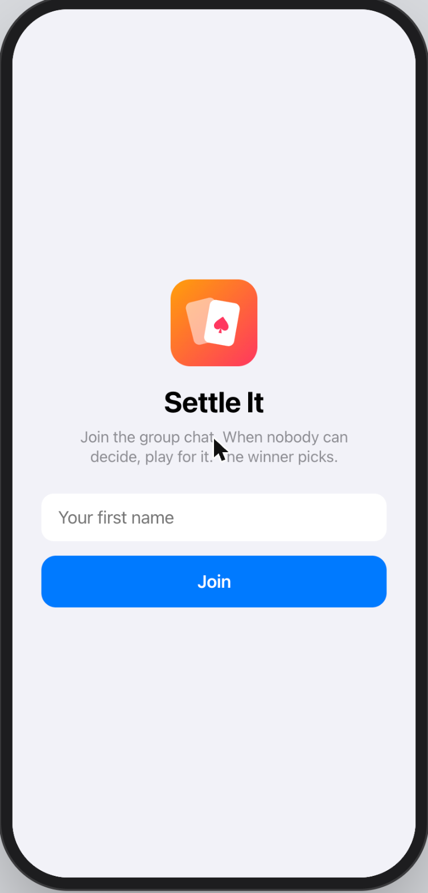<br>**Join.** Each tester types their name on their own phone. | 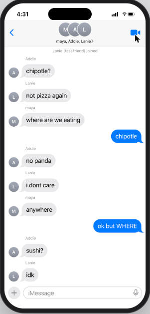<br>**The problem.** The chat goes in circles. Nobody decides. | <br>**Find it.** Settle It lives in the iMessage + drawer, like GamePigeon. |
| 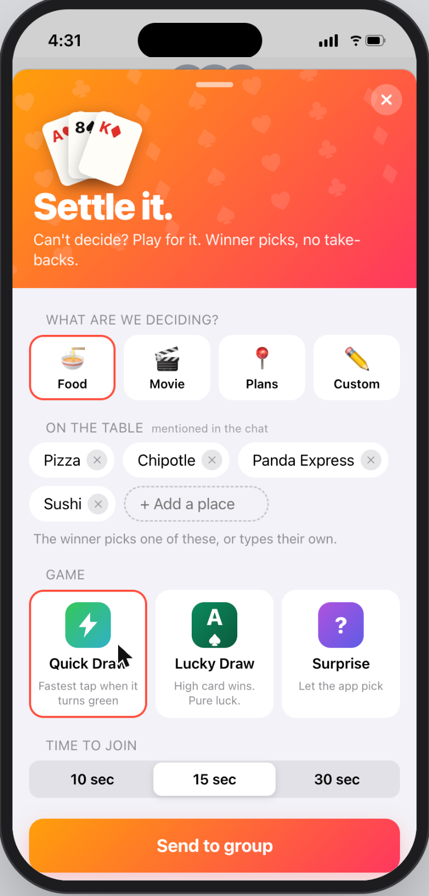<br>**Set it up.** Category, the options people mentioned, game, and join time. | 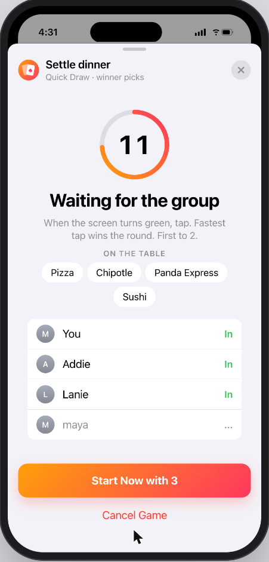<br>**Lobby.** Countdown, what's on the table, and who's in. | 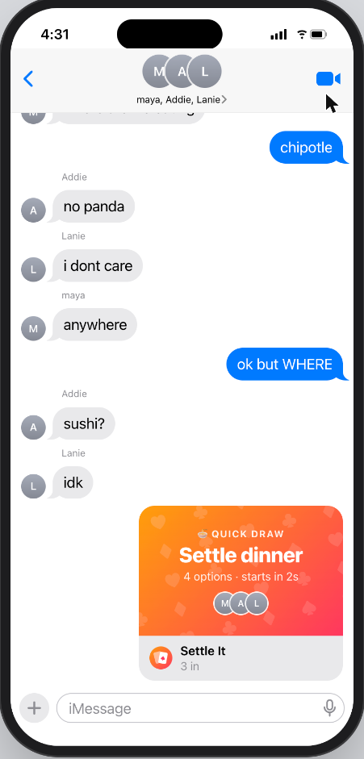<br>**In the chat.** The game posts as an app bubble that updates live. |
| 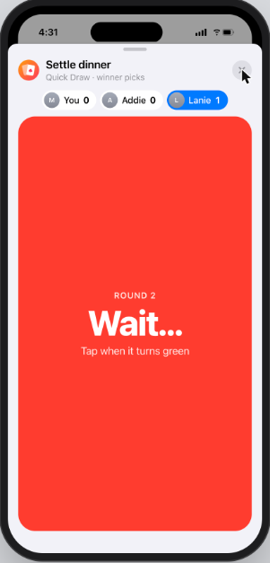<br>**Quick Draw.** Wait for it… | 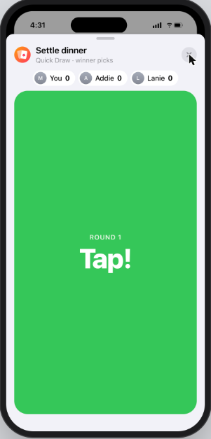<br>**Tap!** Fastest tap wins the round. | 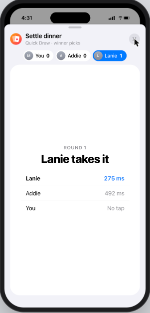<br>**Round results.** Everyone's reaction time. |
| 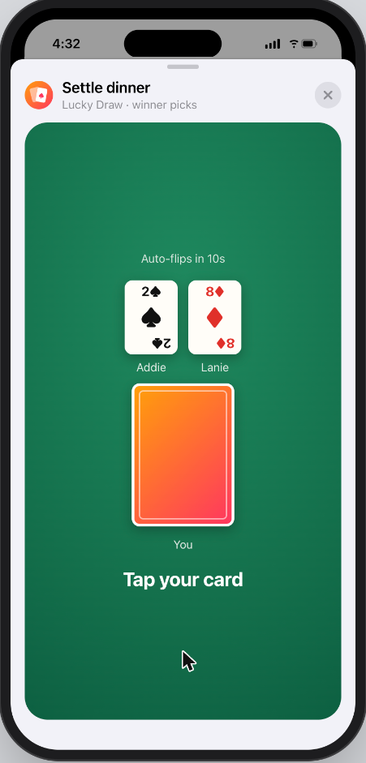<br>**Lucky Draw.** Tap to flip your card. | 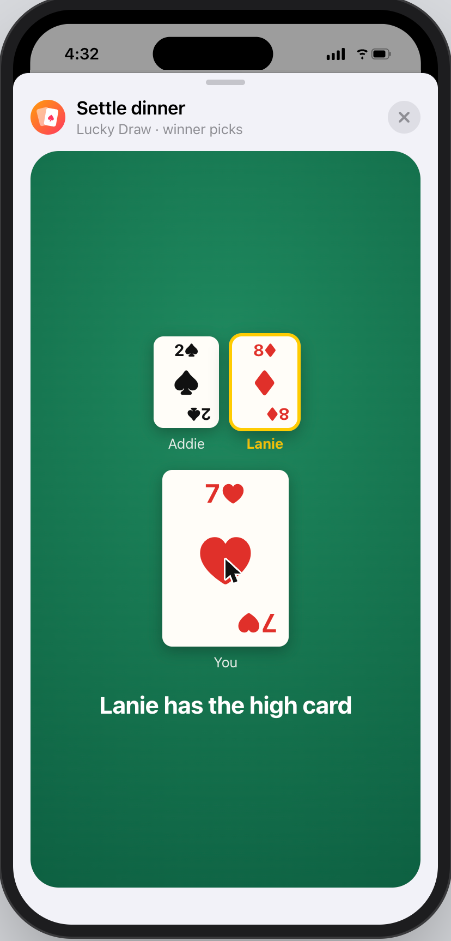<br>**Reveal.** The high card wins. | 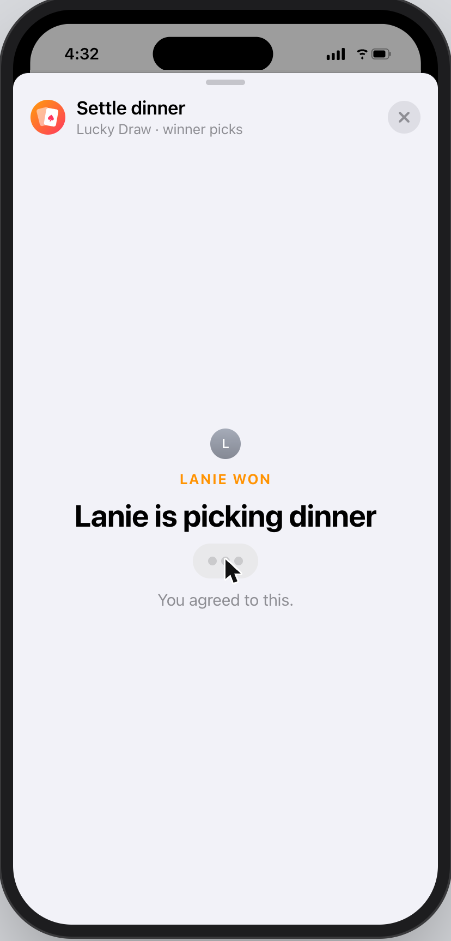<br>**Winner picks.** Everyone else watches the typing dots. |
| 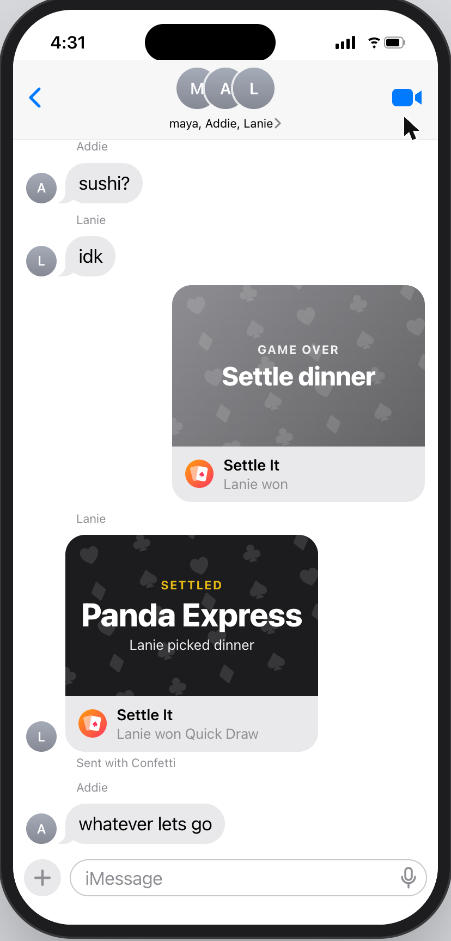<br>**Settled.** The pick lands in the chat with confetti, and the group reacts. | | |

## How the prototype changed while building it
1. **First version:** a plain chat with a big green "game table" screen and an orange Settle it button. It worked, but it didn't feel like a group chat people already use.
2. **Closer to iMessage:** switched to iMessage-style bubbles, the + app drawer, app bubbles in the chat, and iOS sheets, so testers instantly get "this is my group chat."
3. **Test friends text back:** in a solo test, texting the fake friends got no reply, so it felt broken. They now reply with typing dots and push back ("ehh not chipotle").
4. **Customizable setup:** added categories, options on the table, and join time, plus a branded Settle It header so it feels like its own app inside iMessage.
5. **Only real options:** "On the table" first grabbed any short line ("not pizza again"). It now only lists the actual restaurants, activities, or movies people mentioned.
6. **No endless ties:** Lucky Draw once tied 4 rounds in a row. Cards now come from one shared deck with suit tiebreaks, so ties are impossible.

## Run it
Needs Node (no installs, no packages).

```
cd notes/maya/2026-11-04/settle-it-prototype
node server.js
```

The terminal prints two links:
- `http://localhost:3000` for the laptop
- `http://<your-ip>:3000` for phones. They have to be on the **same Wi-Fi** as the laptop.

Each tester opens the phone link and types their name. That's it. Each browser tab counts as its own person, so you can also open several tabs on one laptop to test.

**Testing tools (tap the group name at the top):**
- **Add a test friend** adds a fake person who chats and plays, so you can test with fewer people.
- **Start an argument** drops a "where should we eat" loop into the chat, split across everyone.
- **Clear the chat** resets everything for the next group. People who left are removed too.

## Prototype limits (say these to testers if they ask)
- It's one fake group chat, not real iMessage. A real version would be an iMessage app or a chat bot.
- In Quick Draw the server times every tap. On a shaky Wi-Fi connection a few milliseconds of lag can matter.
- Nothing is saved. Restarting the server wipes the chat.

## Testing
I tested the concept with 5 people: Addie, Lanie, Anthony, Charles, and Megan. All 5 understood "winner picks" right away. The main worries were time ("a card game takes too long") and buy-in ("what if someone won't play or won't accept the pick"). Those worries led to the faster games, the adjustable join timer, optional joining, and the "On the table" list. Full notes and what changed for each tester: [testing-notes.md](testing-notes.md).
