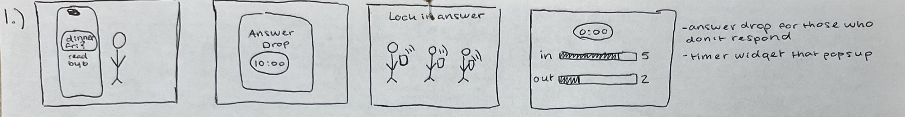
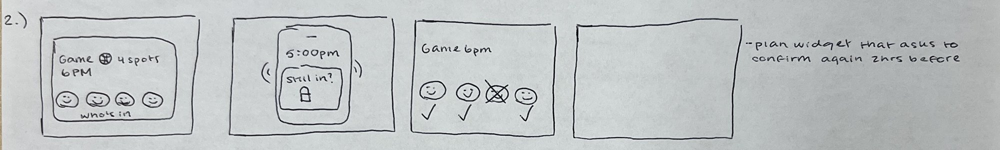
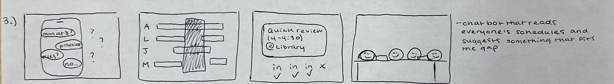
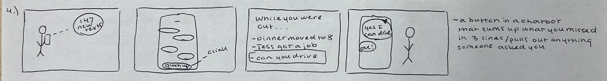
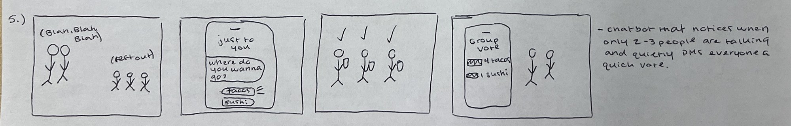
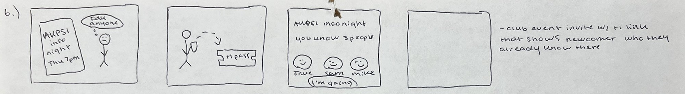
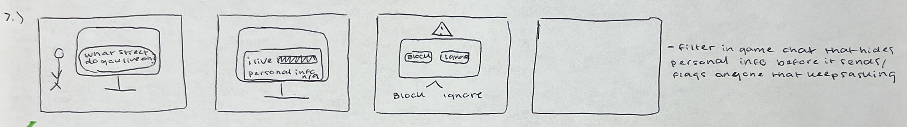
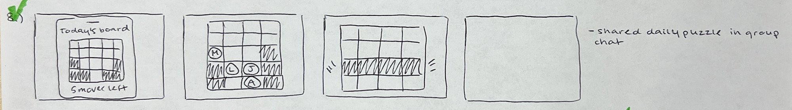
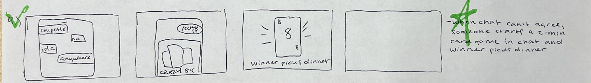
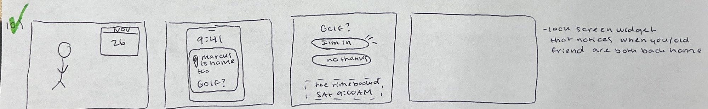

# 11/4 | Maya's Concept Storyboards

10 concept storyboards, sketched by hand. They're based on my interviews with Addie, Lanie and Anthony ([interview notes](../../2026-11-03/maya-interview-notes.md)). Each concept has a software piece, but none of them is a standalone app. The full idea list is in [maya-storyboard-ideas.md](../maya-storyboard-ideas.md).

Full sheets: [concepts 1–5](storyboards-sheet-1-concepts-1-5.jpg) · [concepts 6–10](storyboards-sheet-2-concepts-6-10.jpg)

Concepts 8, 9 and 10 have green checkmarks on the sheet, and concept 9 also has a green star.

---

## 1. Answer Drop

**My note:** "Answer drop for those who don't respond. Timer widget that pops up."
**From:** Addie: people who read the text and don't reply "drive me crazy."
1. A phone shows "dinner Fri?" read by 6. No replies.
2. An Answer Drop with a 10:00 timer.
3. Lock in answer: everyone's phones buzz and they tap an answer.
4. The timer hits 0:00 and every answer shows at once: in 5, out 2.

## 2. Lock It In

**My note:** "Plan widget that asks to confirm again 2 hrs before."
**From:** Addie: people who say yes and don't show up. All 3 interviewees had plans fall through at the last minute.
1. A plan card: Game, 6PM, 4 spots, who's in.
2. A lock screen alert at 5:00pm: "Still in?"
3. One person doesn't confirm and gets crossed off. Three checks.
4. *(blank)*

## 3. The 30-Minute Plan

**My note:** "Chatbot that reads everyone's schedules and suggests something that fits the gap."
**From:** Lanie: a study session fell through because the group "couldn't find more than 30 minutes" when everyone was free.
1. Group chat: "mon at 3?", "practice", "tues?", "no..."
2. A, L, J and M's schedules stacked up. The shared free gap is shaded.
3. The bot suggests a quick review, 4–4:30, at the library. In, in, in, one x.
4. Four friends at a table together.

## 4. Catch Me Up

**My note:** "A button in a chatbot that sums up what you missed in 3 lines / pulls out anything someone asked you."
**From:** Lanie gets "five chats behind" when the group chat moves too fast.
1. Lanie gets out of practice to 147 new texts.
2. She clicks "catch me up."
3. While you were out: dinner moved to 8, Jess got a job, and "can you drive" is boxed.
4. She replies "yes I can drive" and gets an "ok!"

## 5. Pass the Mic

**My note:** "Chatbot that notices when only 2–3 people are talking and quietly DMs everyone a quick vote."
**From:** Anthony: "communication is held between a few people" and the rest are left out.
1. Two people go "blah, blah, blah" while three others are left out.
2. A DM just to you: "where do you wanna go?" Tacos or sushi.
3. The quiet people vote on their phones.
4. Group vote: 4 tacos, 1 sushi.

## 6. Bring-a-Friend Pass

**My note:** "Club event invite w/ +1 link that shows newcomer who they already know there."
**From:** All 3 joined groups through someone they knew. Anthony wants to join AKPsi but isn't in any groups yet.
1. AKPsi info night flyer, Thu 7pm. Anthony thinks "I don't know anyone."
2. A friend sends him a +1 pass.
3. AKPsi info night: "You know 3 people" (Jake, Sam, Mike). "I'm going."
4. *(blank)*

## 7. Info Shield

**My note:** "Filter in game chat that hides personal info before it sends / flags anyone that keeps asking."
**From:** Anthony was threatened in Roblox as a kid by someone who named his cousin's street. Addie ran into older men on Omegle and Fortnite.
1. A stranger in a game asks "what street do you live on?"
2. "I live ▇▇▇▇": the personal info gets hidden.
3. A warning pops up with Block or Ignore.
4. *(blank)*

## 8. Group Puzzle ✓

**My note:** "Shared daily puzzle in group chat."
**From:** Anthony: Block Blast "multiplayer would be pretty cool." Addie plays Candy Crush, Sudoku and crosswords.
1. Today's board: 5 moves left.
2. Each friend (M, L, J, A) makes one move.
3. A row clears.
4. *(blank)*

## 9. Settle It ✓ ★

**My note:** "When chat can't agree, someone starts a 2-min card game in chat and winner picks dinner."
**From:** Addie loves iMessage Crazy Eights because "you can't cheat on it."
1. The chat goes in circles: chipotle, no, idc, anywhere.
2. /settle it opens a round of Crazy 8s.
3. Someone plays an 8. Winner picks dinner.
4. *(blank)*

## 10. Both Home ✓

**My note:** "Lock screen widget that notices when you/old friend are both back home."
**From:** Anthony: with friends from home, "every time I see him it's like we've been talking for the past year."
1. Anthony, Nov 26 on the calendar.
2. Lock screen at 9:41: "Marcus is home too. Golf?"
3. Golf? I'm in / No thanks. Tee time booked, Sat 9:00 AM.
4. *(blank)*
