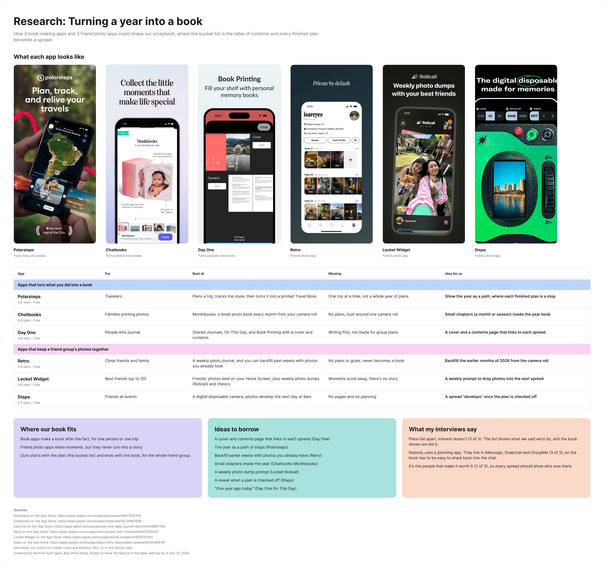
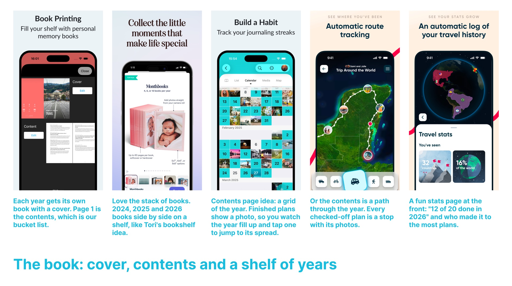
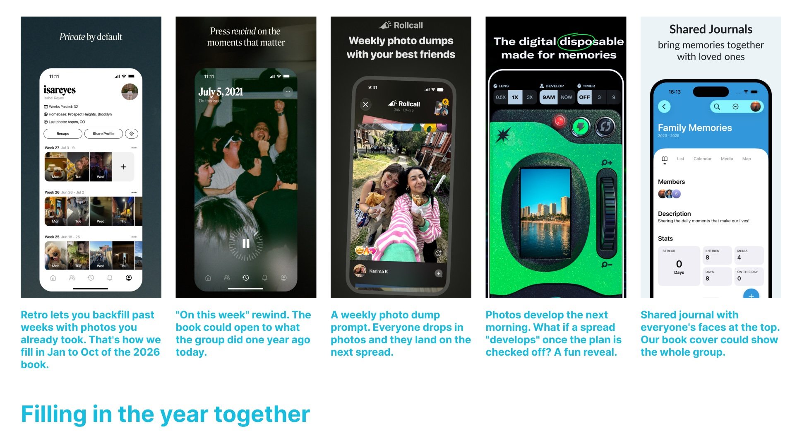
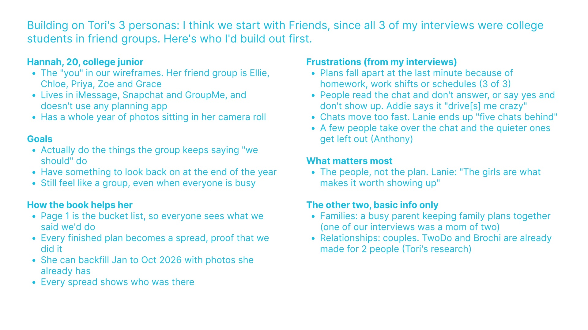

# 11/10 | Maya's Work

## 1. Multiplayer demo
Built a shared whiteboard where several people can draw on the same board at the same time from one link. It's online, so anyone with the link can join. Made with tldraw sync for the "multiplayer proof of concept before Wednesday" assignment.

- **Try it:** https://mayawalsh19-art.github.io/multiplayer-poc/?room=class
- **Code and how it works:** [notes/multiplayer-poc](../../multiplayer-poc/)

## 2. Research: turning a year into a book
Compared 6 apps that could shape our scrapbook: 3 that turn what you did into a book (Polarsteps, Chatbooks, Day One) and 3 that keep a friend group's photos together (Retro, Locket, Dispo). Tori and Leandra already covered bucket list apps, scrapbook apps and Canva, so I didn't repeat those.

**Main takeaway:** book apps only make a book after the fact, for one person or one trip, and friend photo apps never turn into a story. Ours starts with the plan (the bucket list) and ends with the book, for the whole group.

## 3. Inspo boards
Two boards of app screenshots with my notes on what we could borrow.

**The book: cover, contents and a shelf of years**

**Filling in the year together**

## 4. Persona notes
Built on Tori's 3 personas and suggested we start with Friends. I built out Hannah, 20, a college junior, using what I heard in my 3 interviews: her goals, her frustrations, and how the book helps her.

## 5. README and crit notes
- Wrote our final idea in the [README](../../../README.md): a shared scrapbook book for each year, with the bucket list on page 1. Also rewrote "Who we're designing for, and why" and linked our Figma file.
- Typed up Monday's [crit notes](../../crit/2026-11-09/crit-notes.md).

All of the research, inspo and persona work is also in our [Figma file](https://www.figma.com/design/eXyBNM0n3Ky0jqW9cRPPvq/Bring-People-Together).
