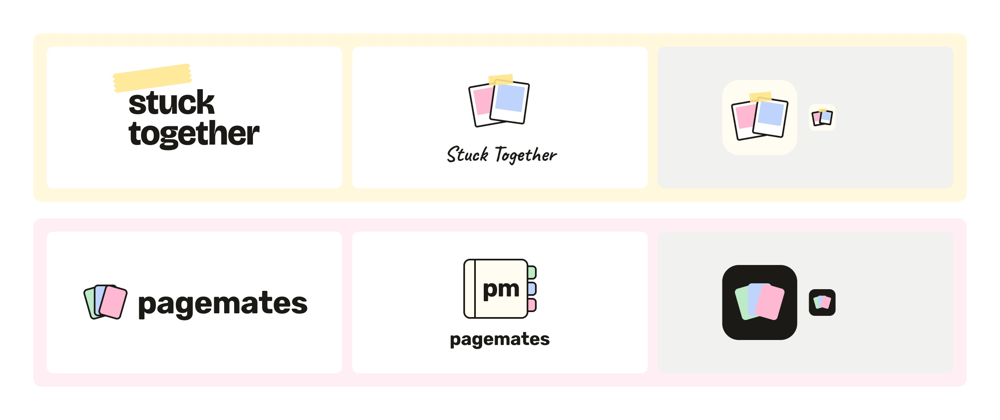
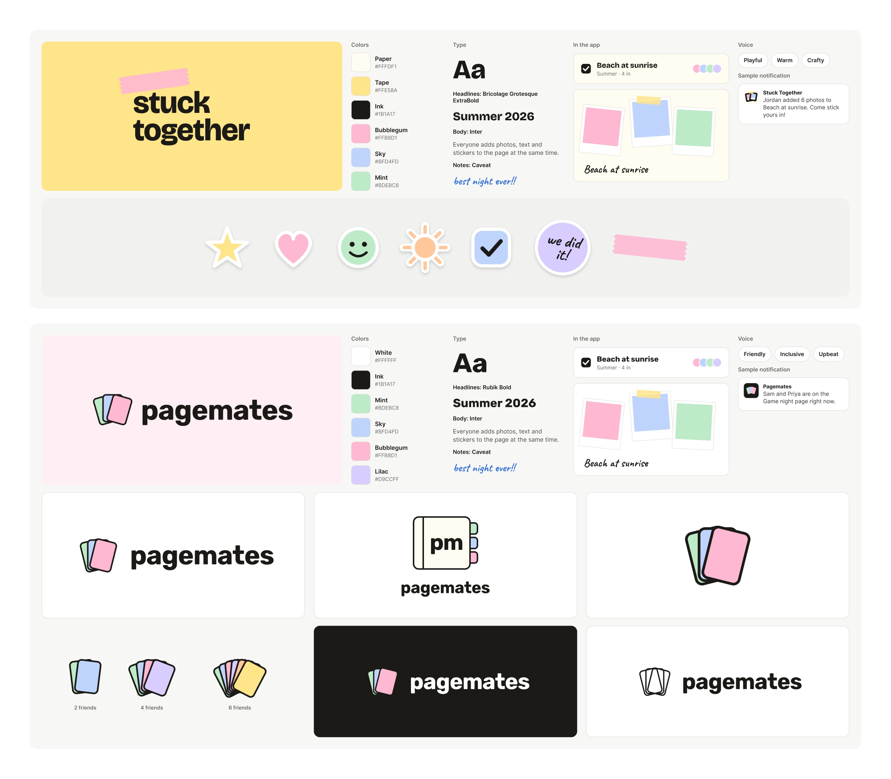

# 11/12 | Maya's Work

## 1. Branding and logo options
Brainstormed names for the app, then narrowed them to two: **Stuck Together** and **Pagemates**. Made logo and branding options for both on the Branding page in [our Figma file](https://www.figma.com/design/eXyBNM0n3Ky0jqW9cRPPvq/Bring-People-Together?node-id=26-2).

**Logo ideas**

**Branding ideas**

## 2. Threats
Created [threats.md](../../../threats.md) and filled it out.
