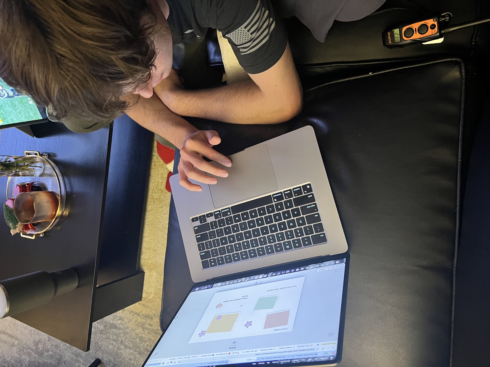
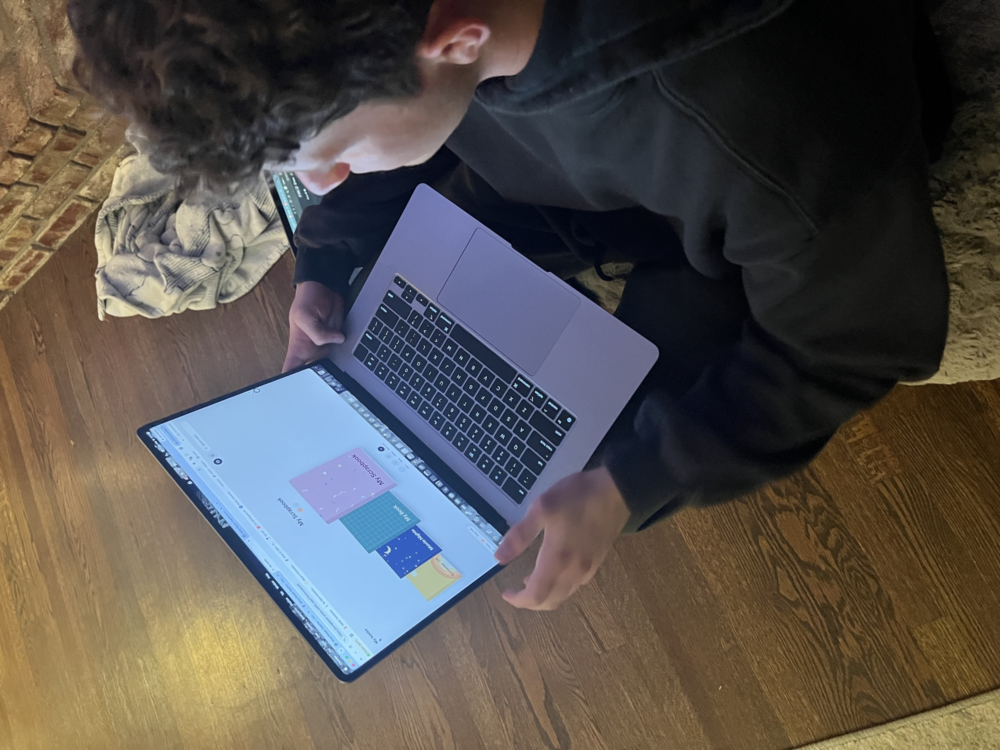
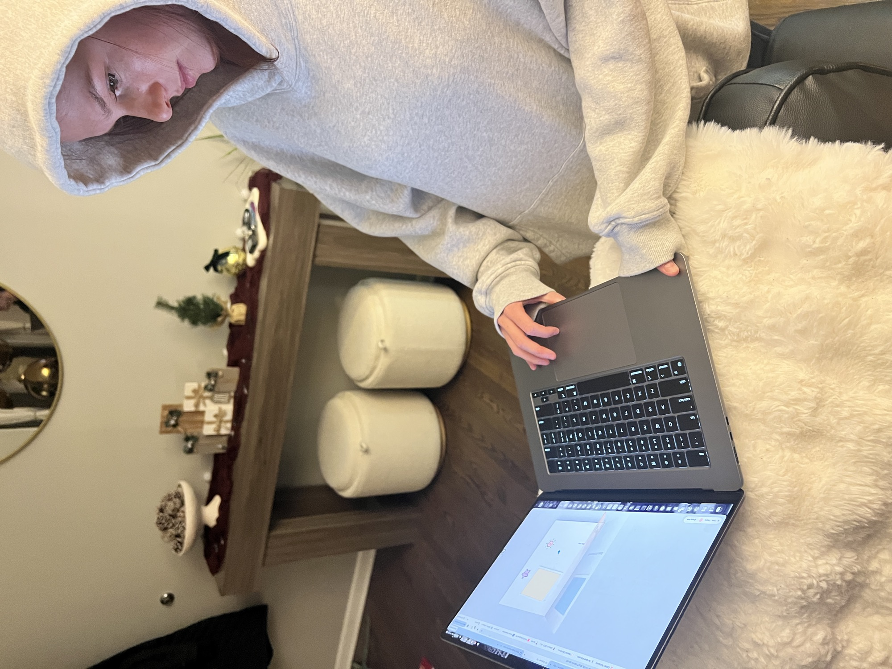

# 11/15 | Scrapbook user testing

Sunday, November 15, 2026 · 5 participants · in person

Tested the [live scrapbook](../../../project/2026-11-13-live/) ([try it](https://scrapbook-proto.netlify.app/?room=class)).

## Photos

## Video

[Walkthrough of the shared bucket list and book (3.5 min)](scrapbook-bucket-list-test-walkthrough.mp4)

## What worked

1. **Easy to navigate.** All 5 participants knew exactly what to click, what to edit and how to add things.
2. **Adding friends is easy.** Including and adding friends was simple.
3. **Live presence works.** It shows when several people are in the book at the same time.

## Problems

1. **Stickers can't be deleted.** Once you add a sticker, you can't remove it.
2. **Stickers show up on every spread.** A sticker added on one spread stays on all the spreads.

## Next steps

- Add a way to delete text, stickers and photos.
- Keep each sticker on the spread it was added to.
