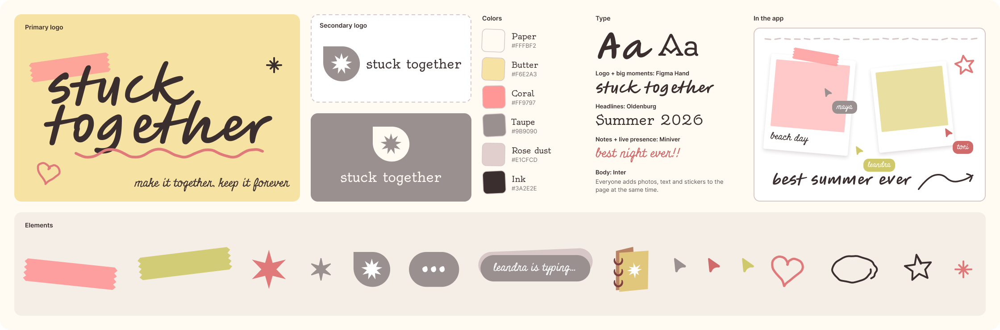
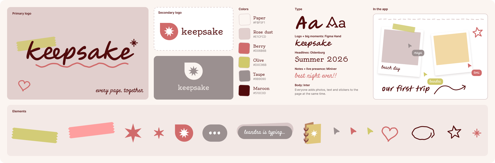
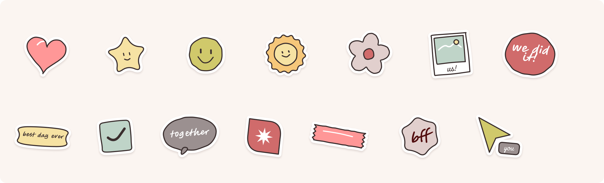
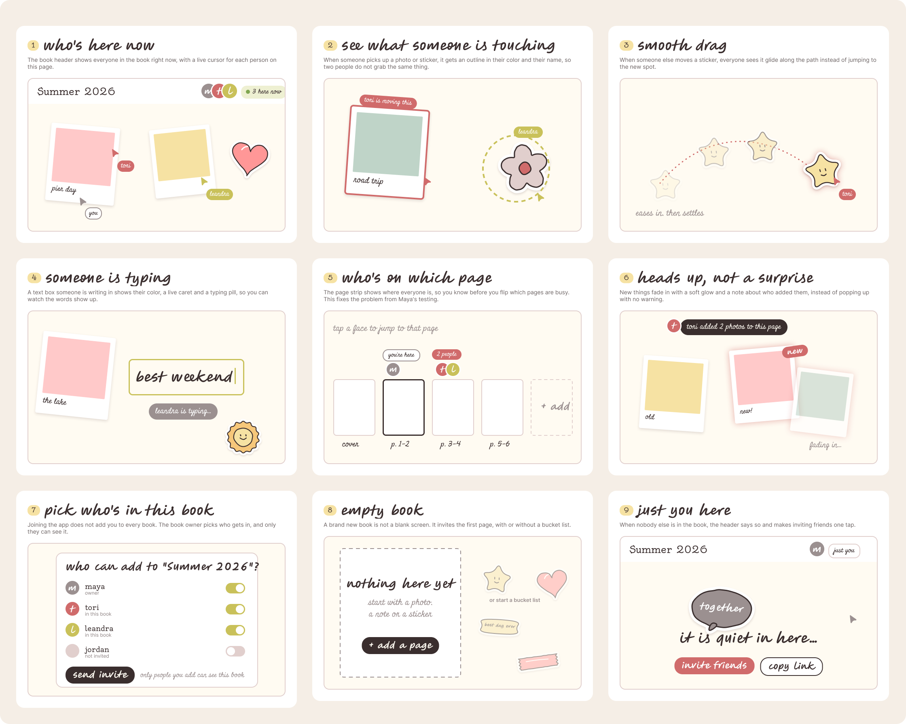

# 11/17 | Maya's Work

All of this is on the Branding page in [our Figma file](https://www.figma.com/design/eXyBNM0n3Ky0jqW9cRPPvq/Bring-People-Together?node-id=149-11).

## 1. Handmade brand boards
Made the logo more handwritten and made two brand boards with a crafty, handmade feel, based on Tori's Figma comments.

- **Logo font:** Figma Hand (Tori's pick)
- **Secondary font:** Oldenburg (Tori's pick)
- **Notes font:** Miniver
- **Elements:** Leandra's and Tori's shapes, the Stuck Together tape, and new hand-drawn doodles

**Stuck Together**

**Keepsake**

## 2. Sticker set
Made 14 hand-drawn stickers in the same style. Each one is a component in Figma, so we can reuse them.

## 3. Multiplayer states
Designed 9 states based on the 11/16 crit notes and our weekend testing: who's here, what someone is touching, smooth drag, someone typing, who's on which page, a heads up when something changes, picking who's in a book, an empty book, and being the only one there.

