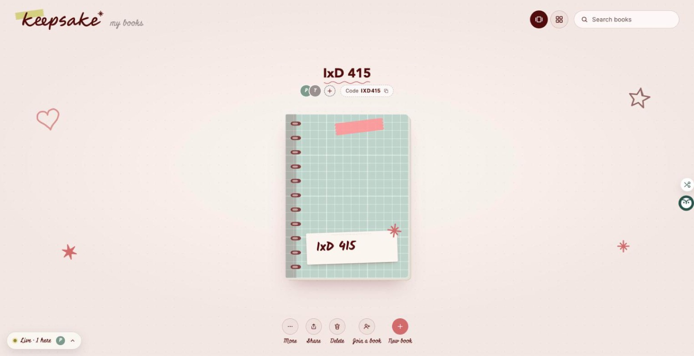
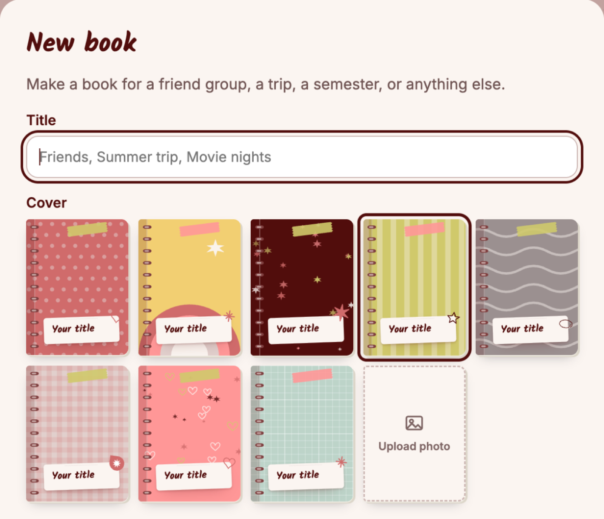
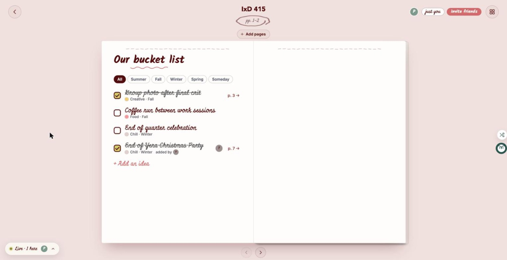
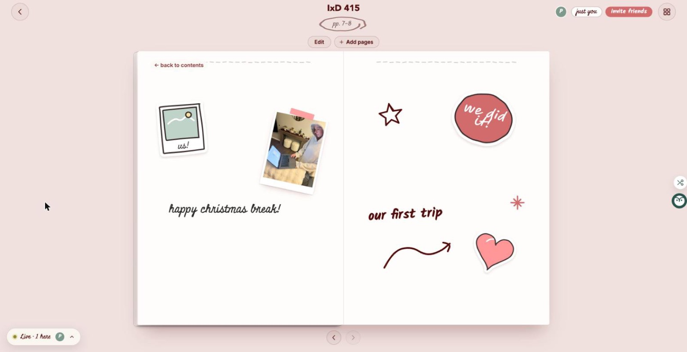
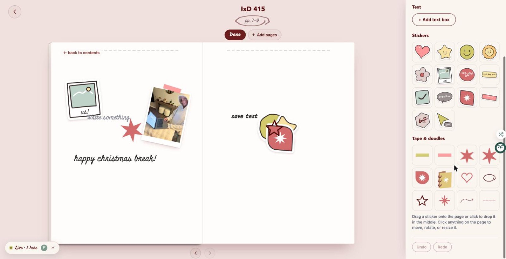
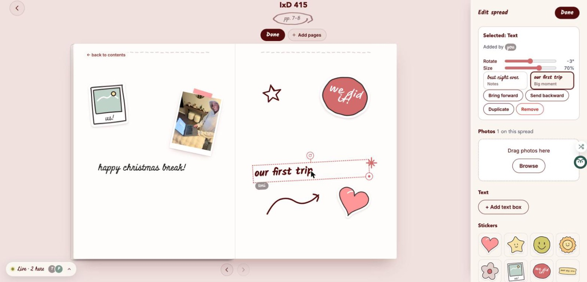
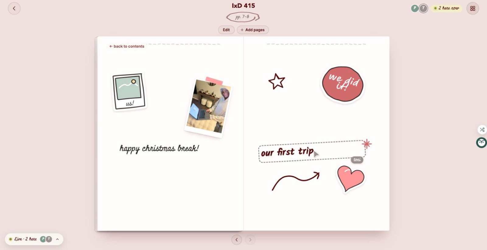
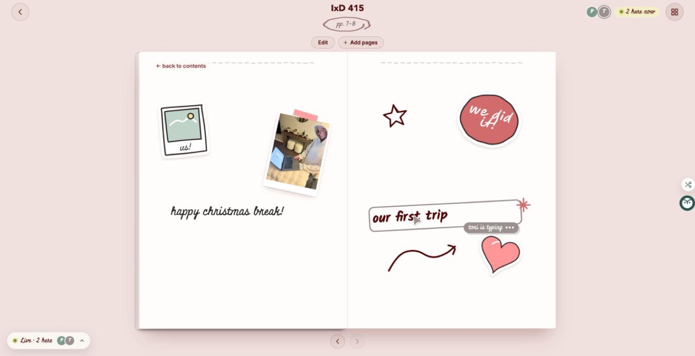

# 11/18 | Maya's Work

Branded the scrapbook prototype as **Keepsake** with Claude Code, using my handmade brand boards, sticker set and multiplayer states from the Branding page in [our Figma file](https://www.figma.com/design/eXyBNM0n3Ky0jqW9cRPPvq/Bring-People-Together?node-id=149-11).

The branded version is its own folder, [project/2026-11-18-keepsake](../../../project/2026-11-18-keepsake/), copied from Leandra's live version with her safety features. The 11/13 live folder and its Netlify link are unchanged. Both use the same Firebase books, so `?room=class` shows the same books in the new look.

## What changed

- **Logo:** the real Keepsake logo from Figma, with "every page, together" under it
- **Colors:** Paper, Rose dust, Berry, Olive, Taupe and Maroon everywhere, including everyone's person color
- **Fonts:** changed the secondary font from Oldenburg to **Avenir**. Headlines are Avenir, notes and name tags are Miniver, and body text is Inter. Big moments use Kalam Bold because Figma Hand isn't a web font.
- **Note fonts:** select a note to pick **Notes** (Miniver) or **Big moment** (Kalam)
- **Stickers:** all 14 stickers from my sticker set
- **Tape & doodles:** every element from the brand board, including the olive and pink tape, the stars, the little notebook, and the hand-drawn heart, circle, star, sparkle, arrow and underline
- **Covers:** every cover is now a Keepsake notebook with spiral rings, tape, a paper label and a doodle
- **Pages:** a stitched edge across the top of each page, and tape on every photo
- **All 9 multiplayer states:**
  1. who's here now
  2. what someone is touching
  3. smooth drag
  4. someone is typing
  5. who's on which page
  6. a heads up when someone adds something
  7. invite codes
  8. an empty book
  9. "just you" with an invite button

## Testing and fixes

I tested it myself and made a page. It looked like my progress was gone and I couldn't remove a heart sticker. My page had actually saved, but we found two ways changes could disappear without a message, and fixed both:

- **Edits made while it was still connecting were thrown away.** Now Edit waits until the books have loaded.
- **A save the database refused vanished silently.** Now it tries again, and shows a message if it still can't save.
