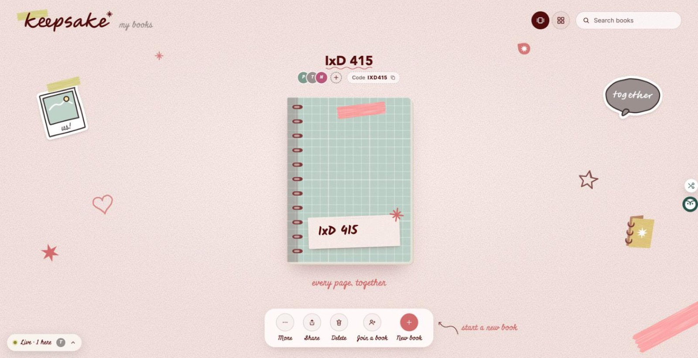
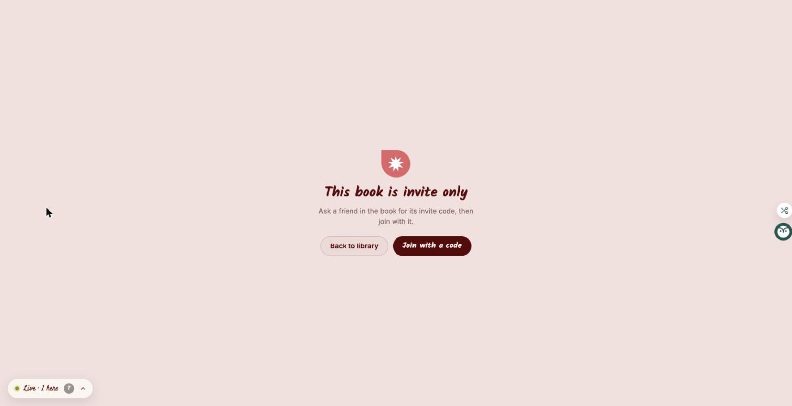
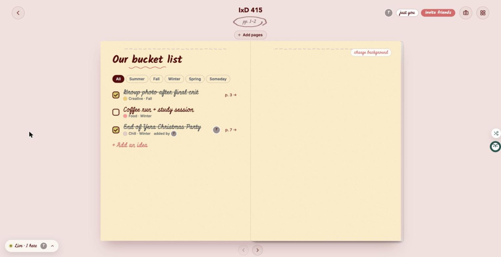
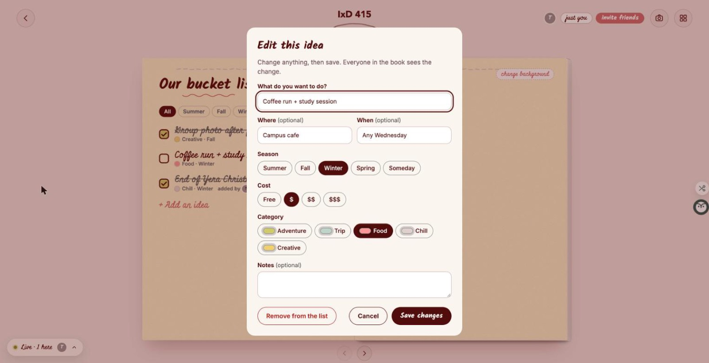
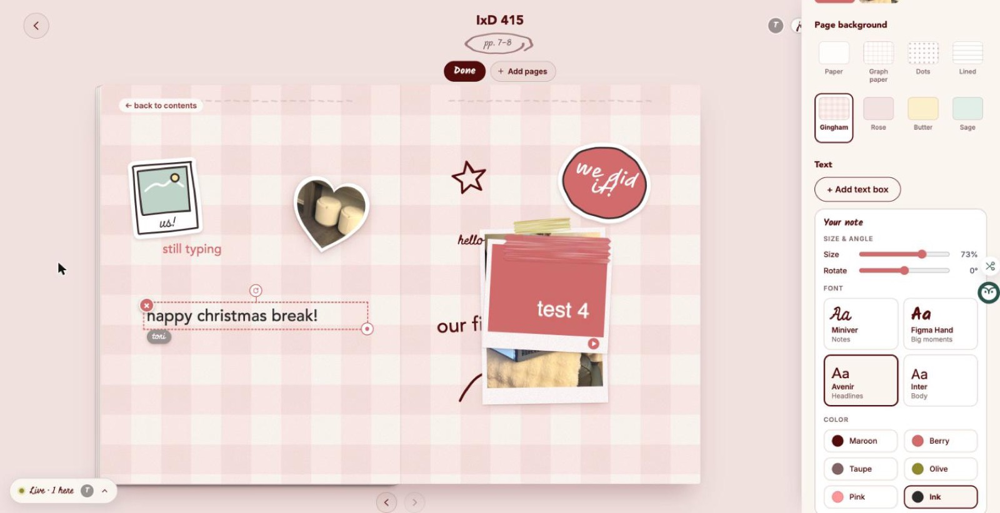
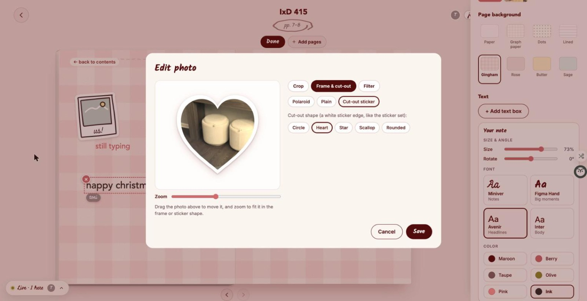
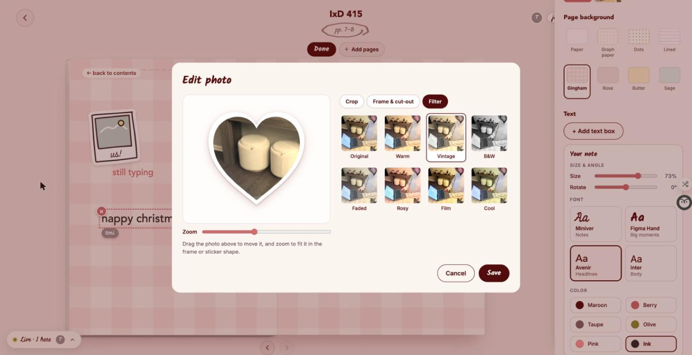
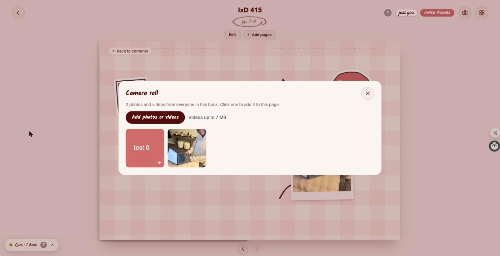

# 11/19 | Maya's Work

Fixed every item from the [11/18 crit notes](../../crit/2026-11-18/crit-notes.md) in the [Keepsake prototype](../../../project/2026-11-18-keepsake/) with Claude Code, then cleaned up the design and added texture. The full list of changes is in the [prototype README](../../../project/2026-11-18-keepsake/README.md).

**To put it online, Leandra needs to:** drag [keepsake-netlify-drop.zip](../../../project/keepsake-netlify-drop.zip) onto the Netlify site's Deploys page, and publish the new Firebase rules for videos. The steps are at the top of the [README](../../../project/2026-11-18-keepsake/README.md#to-do-for-leandra-1119-put-the-new-changes-online).

## Crit fixes

- **Books and joining:** an invite code only gets you into that one book, and deleting a book only removes it from your own books
- **Bucket list:** edit or remove ideas, and change the bucket list's background
- **Editing the page:** a × to remove things, videos, a recently uploaded row, and a camera roll for each book
- **Photos:** a photo editor (double-click any photo) to crop, zoom, make a cut-out sticker, change the frame, or add a filter
- **Tape:** change the color of tape stickers and the tape on photos
- **Fonts:** every brand board font (Miniver, Figma Hand, Avenir, Inter) and note colors, in a redesigned note dropdown
- **Live presence:** click someone in the who's here list to follow them to their pages

## Design cleanup

- Home page: more branding elements, the "every page, together" tagline, and better spacing
- Edit panel: roomier colors, even selection rings, and everything for a note in one place
- Texture: washi tape, the notebook, covers and pages look like real paper (also updated in Figma)

  
  
  
  

  
  
  
  

