# 11/22–11/23 | Keepsake user testing

10 of 10–15 testers so far · on their phones · screen recordings

Tested the [live Keepsake site](https://keepsake2.netlify.app/), joining the class book with the code **IXD415**.

## Screen recordings

- [Maya Zech (33 sec)](recordings/maya-zech-keepsake-test-recording.mp4)
- [Audrey (2.5 min)](recordings/audrey-keepsake-test-recording.mp4)
- [Mason (1 min)](recordings/mason-keepsake-test-recording.mp4)
- [Chris (1.3 min)](recordings/chris-keepsake-test-recording.mp4)
- [Max (1.5 min)](recordings/max-keepsake-test-recording.mp4)
- [Mom (3 min)](recordings/mom-keepsake-test-recording.mp4)
- [Lily (2 min, 11/23)](recordings/lily-keepsake-test-recording.mp4)
- [Cami (3.7 min, 11/23)](recordings/cami-keepsake-test-recording.mp4)
- [Emmie (2.3 min, 11/23)](recordings/emmie-keepsake-test-recording.mp4)
- [Alyssa (4.3 min, 11/23)](recordings/alyssa-keepsake-test-recording.mp4)

Audrey's and Mom's camera rolls are blurred for the few seconds their phone's photo picker is open.

## Maya Zech

**What she said:** It was very fun and easy to use, and it made sense right away that her task was to add to the scrapbook.

**From the recording (33 sec, Snapchat's in-app browser):**
- The recording starts with her already in the class book, so joining isn't shown.
- Flipped through the full photo collage spread, Audrey's dog photo (still uncropped), a face cut-out sticker, and the empty pages that say "nothing here yet" with **Add pages** at the end.
- Flipped back to the bucket list, went back to the shelf, opened the grid view, then reopened the book on the bucket list.
- Near the end the live bar changed from "1 here" to "2 here" as someone else joined the book.
- She didn't zoom in on anything, unlike Mason and Chris.
- She said her task was to add to the scrapbook, but adding isn't in this clip. It may have happened before or after the recording.

  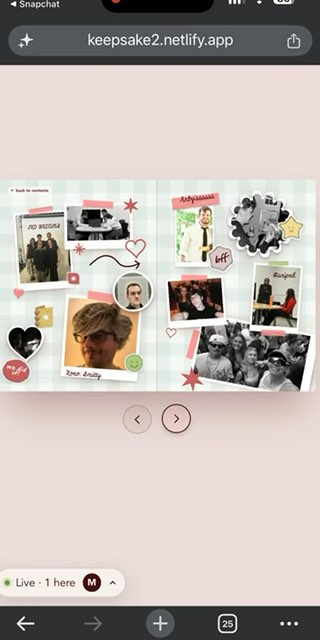
  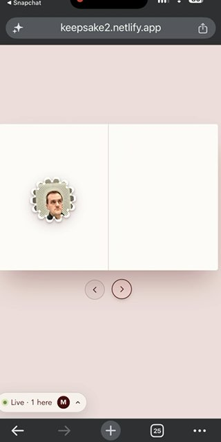

## Audrey

**What she said:** She really liked the idea and thought it was super easy to use. She got stuck in the photo cropping and couldn't save it, no matter what she tried.

**From the recording (2.5 min, Safari):**
- Flipped through the class book, tapped **Edit**, added a photo of her dog from her camera roll with **Browse**, and tapped **Done editing**. No trouble with any of it.
- Opened the photo editor and spent over a minute on **Crop**. She picked **Square** and kept dragging the crop box, but the photo preview sits above the crop area, so she couldn't see the result while cropping.
- **Cancel** and **Save** sit at the very bottom of the editor. Most of the time they were scrolled off screen or hidden behind Safari's toolbar. They only showed up for a second or two when she scrolled all the way down.
- She tried everything else in the editor: polaroid tape colors, Plain, all the filters, and the circle, heart, star and rounded cut-outs. She settled on the heart, then switched back to the polaroid with pink tape.
- The recording ends with the editor still open. **Save** was never tapped.
- Confirmed in Chris's recording: her dog photo is still on pages 11–12 as a plain, uncropped polaroid, so none of her edits were saved.

  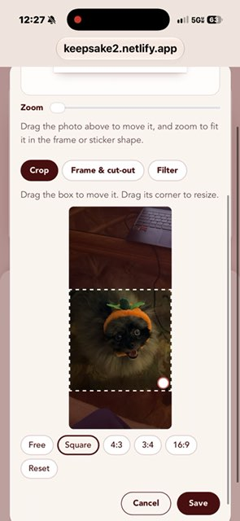
  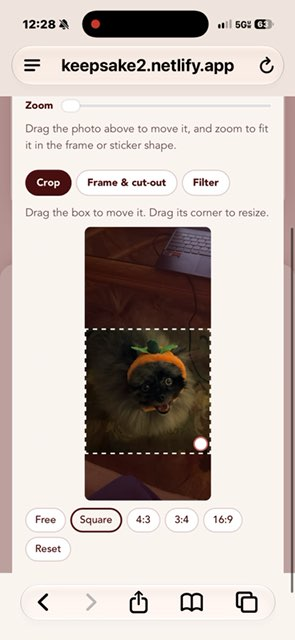
  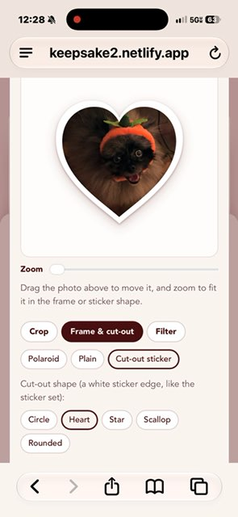

## Mason

**What he said:** He thought it was a cool concept but was confused about what he was supposed to do. The book with the pictures on it was awesome, and he liked how the pages flip like a real book.

**From the recording (1 min, in-app browser):**
- Typed his name and joined with **IXD415** with no trouble ("Joined IxD 415" showed).
- Flipped through every page from the bucket list to pages 13–14, where it ends at **Add pages**.
- Pinched to zoom in on a page to read it, which suggests the text and photos are small on a phone.
- Went back to the shelf, tapped the grid view ("Click a book to select it. Click again to open it."), then switched back to the shelf.
- Never tapped **Edit**, **New book** or anything that adds to the book. After joining, nothing tells you what to do next, which matches his confusion.

  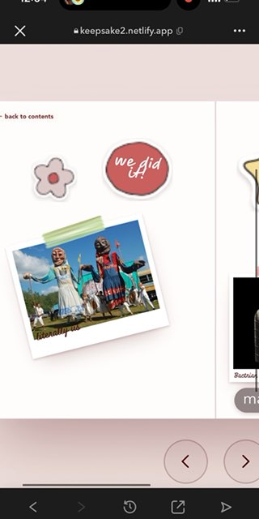
  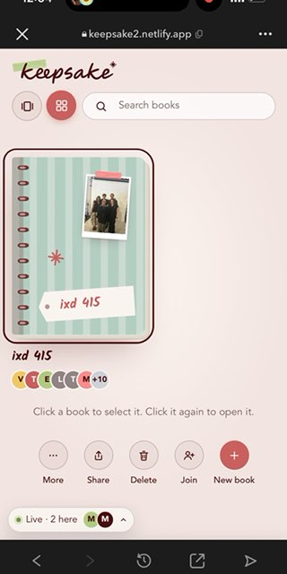

## Chris

**What he said:** It makes sense, and it was easy to use and update. He really liked the overall look and feel, and the idea.

**From the recording (1.3 min, Snapchat's in-app browser):**
- Typed his full name. Snapchat then popped up its own "Save info for next time?" sheet over the page.
- Joined with **IXD415**. For a moment the cover polaroid was blank while the photo loaded.
- Tapped the grid view, then the search bar by accident (the keyboard came up), then went back to the shelf.
- Opened the book and pinched to zoom in on the bucket list to read it. He tapped the season filters (Summer, Winter, Someday), and they worked. Someday was empty.
- Kept zooming in to look at the pages as he flipped through.
- Ended on pages 13–14 without tapping **Edit**, the same as Mason.

  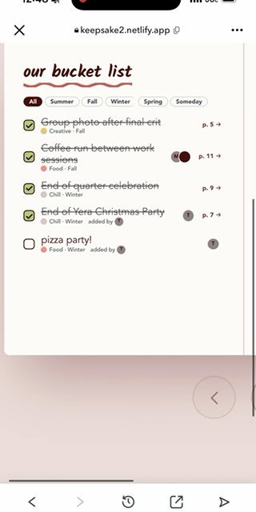
  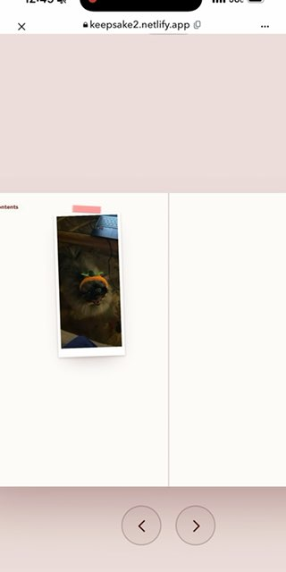

## Max

**What he said:** Fairly easy to use, but he didn't understand it at first.

**From the recording (1.5 min, Safari):**
- Typed his full name and joined, but the invite code took 3 tries: **IXS415** ("There's no book with that code. Check it and try again."), then **IXD414**, then **IXD415**. The error message helped him fix it.
- Flipped through the book and went back to the bucket list a few times.
- Unlike Mason and Chris, he found **Edit**. He opened the Edit spread panel on pages 5–6, 7–8, 11–12 and 15–16, then tapped **Done editing** each time without adding anything.
- Ended on the Edit spread panel for pages 15–16 without adding a photo, note or sticker.

  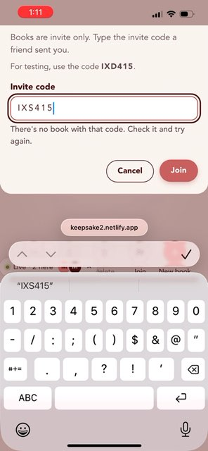
  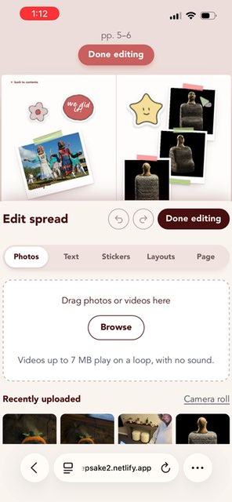

## Mom

**What she said:** She couldn't select a template, but it's a fun little app. She'd already added a photo, so she was confused why the layouts weren't working.

**From the recording (3 min, Chrome):**
- The recording starts with her already in the class book, so joining isn't shown.
- Flipped through to pages 11–12, tapped **Edit**, and added a photo of two dogs from her camera roll to the right page with **Browse**. No trouble.
- With the photo still selected, she tapped the **Text** and **Stickers** tabs, but the panel kept showing the photo's settings. The stickers only showed up after the photo was deselected.
- Added a red sticker and dragged it to the top corner of the page.
- Opened **Layouts** and switched between **Left page** and **Right page**, but the layouts were faded and tapping them did nothing. Both pages already had a photo on them, and layouts only work on a blank page. The message that says so ("The right page already has things on it. Layouts are for starting a blank page.") sits under the layouts, off screen, so she never saw why.
- Tapped **+ Add text box** and wrote "Merry Christmas!!!" above her dogs.
- Pinched to zoom in on the page a few times while editing, like Mason and Chris.
- Tapped **Done editing**. Her photo, sticker and note all stayed on the page.

  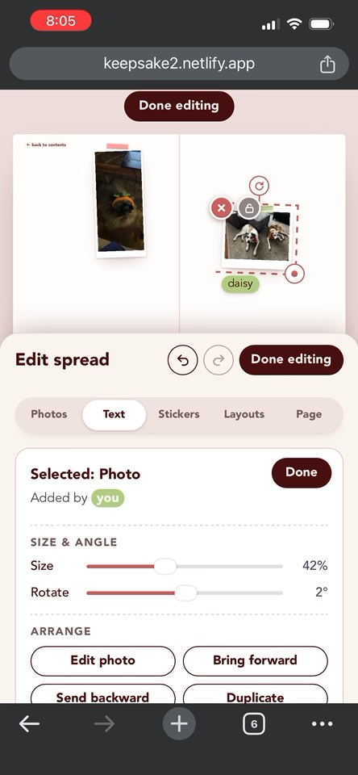
  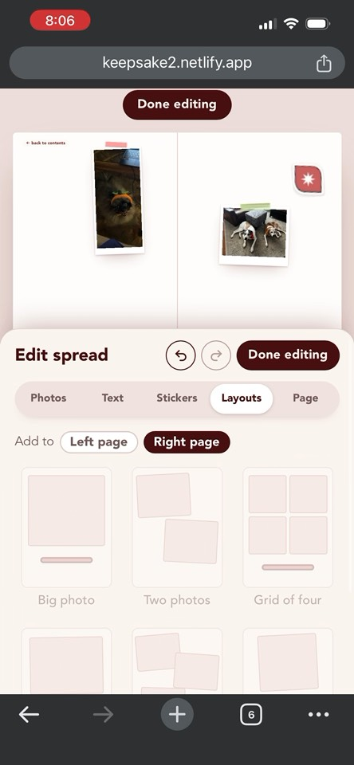
  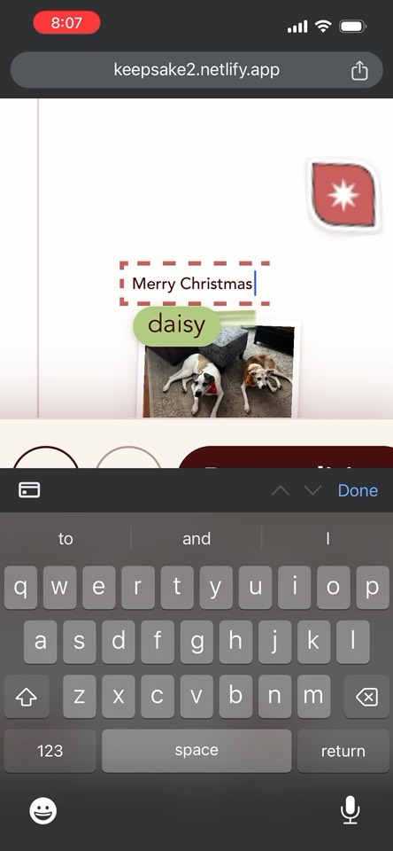
  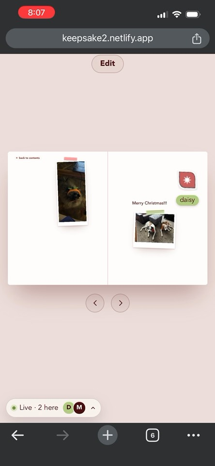

## Lily (11/23)

**What she said:** She understood the concept but was super confused at first about how to join a book. Overall she thought it was a cute concept, and once she got in she picked it up right away.

**Her first try (recording not included):** In her first screen recording, she tried to add a book and couldn't get it to work. This recording is her second try.

**From the recording (2 min, Safari private tab opened from Messages):**
- On this second try she typed her name and joined with **IXD415** with no trouble ("Joined IxD 415" showed).
- Flipped from the bucket list through every spread to the blank pages 15–16, then tapped **Edit** right away. Unlike Mason and Chris, she found it on her own.
- Looked at **Photos**, then went to **Stickers** and added the smiley star. She made it bigger (22% to 47%) and looked at the tape and doodle stickers too.
- With the star still selected, she tapped **Layouts**, but the panel kept showing the sticker's settings, the same thing that happened to Mom. She tapped **Done editing** and **Edit** again to get out of it.
- On **Layouts**, every layout was faded because the left page had her star on it. This time the message ("The left page already has things on it. Layouts are for starting a blank page.") was on screen under the layouts. She didn't try the blank right page and moved on to **Page**.
- Tried the page backgrounds Paper, Rose and Butter, and picked Sage (green).
- Tapped **+ Add text box** and typed "HIIIIIIII". The keyboard covered most of the page while typing. Then she changed the font to Figma Hand and added the Rose label.
- Tapped **Done editing**. The star, note and green background all stayed. She ended in **All spreads**, where her page shows up as pp. 15–16.

  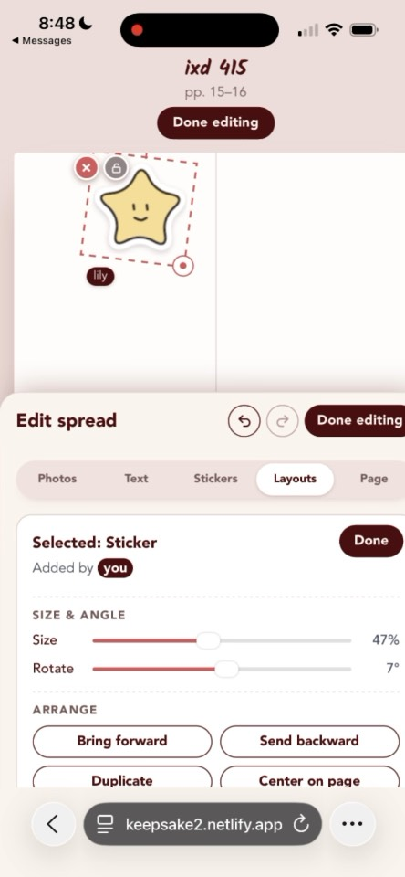
  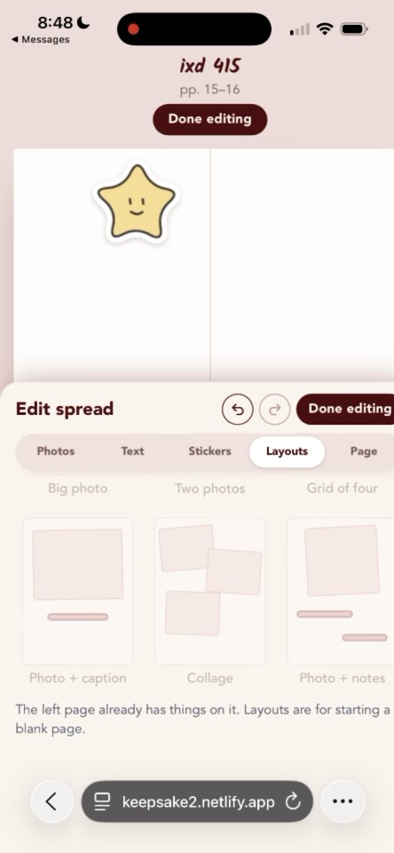
  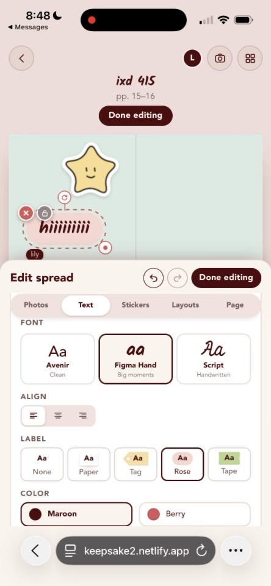
  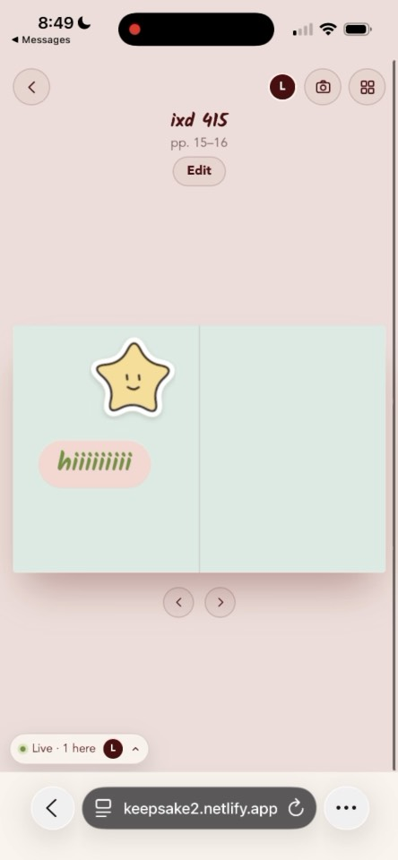
  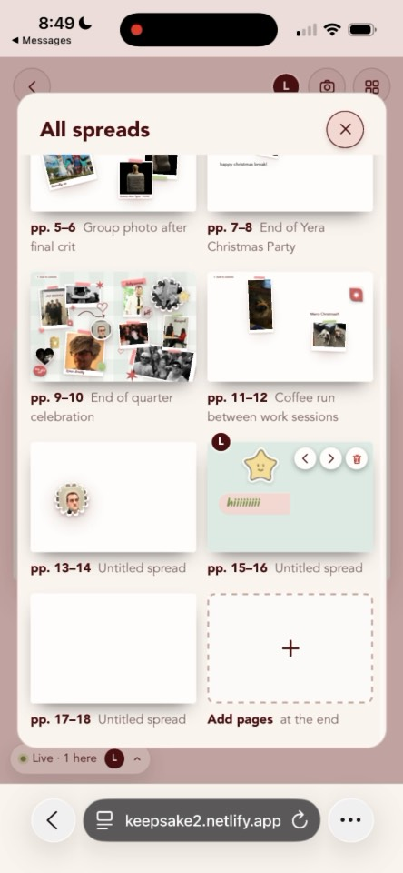

## Cami (11/23)

**What she said:** It's looking good. Her biggest feedback is to make the undo button more obvious, or add a confirmation step before deleting or adding something. She tried to add a caption to the dog picture and accidentally deleted the picture of Stormi.

**From the recording (3.7 min, Snapchat's in-app browser):**
- Typed her name. Snapchat popped up its own "Autofill this form?" and "Save info?" sheets over the page, like it did for Chris.
- Tapped **Join with a code** and joined with **IXD415** on the first try ("Joined IxD 415" showed).
- Flipped through every spread and pinched to zoom in on the photo collage on pages 9–10, like Mason, Chris and Mom.
- Opened the live bar's **Here now** list, which showed her, lean and maya with **follow** buttons.
- Tapped **Edit** on pages 9–10 and tapped one of Victoria's photos. The message "Only Victoria can remove this. You can report it if it's not OK." showed, so she left it alone.
- Opened **Add an idea** on the bucket list but closed it without adding one, then looked at the shelf and **All spreads**.
- Went to pages 11–12, tapped **Edit**, looked at **Layouts**, then went to **Text** and tapped **+ Add text box**. She typed "Hello Stormi 💗" right next to the photo of Stormi.
- When the caption was selected, its delete (X) and lock buttons sat right on top of the edge of Stormi's photo. A second later the Stormi photo was gone, and only her caption was left on the page.
- She tapped undo and redo, but the photo didn't come back. The caption was removed too, so the left page ended up empty. Nothing asked "Are you sure?" before the photo was deleted.

  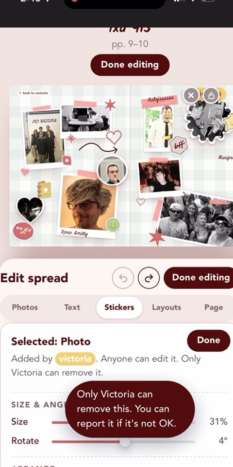
  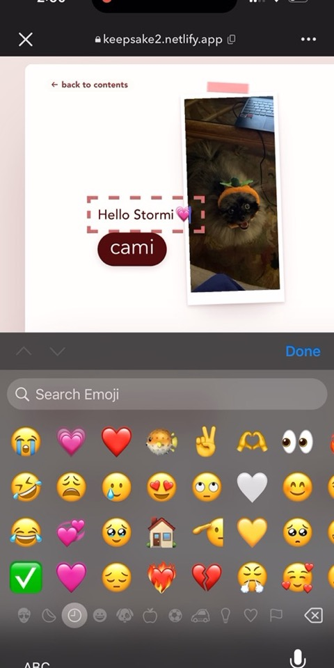
  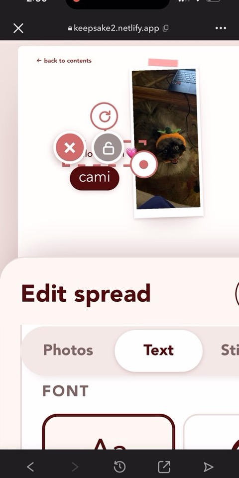
  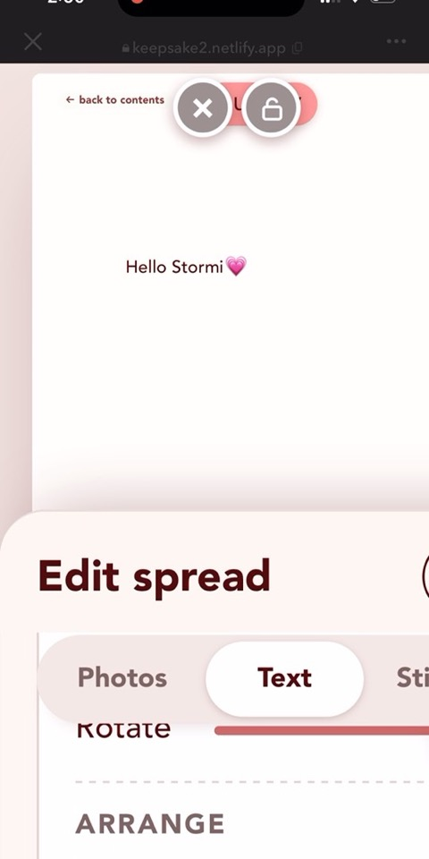
  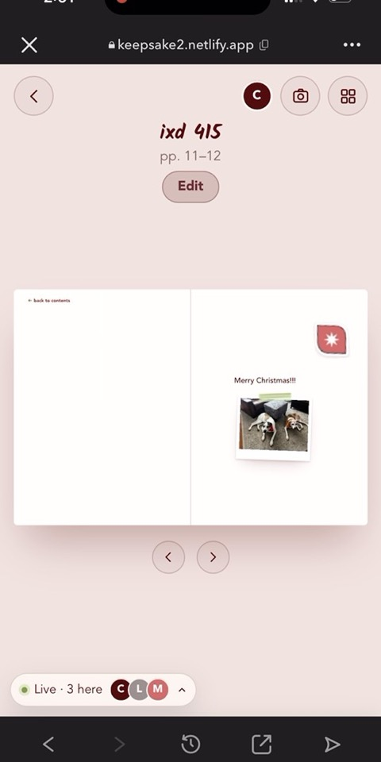

## Emmie (11/23)

**What she said:** It was very self-explanatory. Maybe add an option to share the bucket list.

**From the recording (2.3 min, TikTok's in-app browser, the new phone layout that shows one page at a time):**
- She sent 4 short clips, joined here into one video. The end of one clip showed a private chat, so that part was cut.
- Typed her name. On "You're not in any books yet," she opened **New book** first, then came back and joined with **IXD415** on the first try ("Joined IxD 415" showed).
- Opened the class book to the bucket list and tapped Tori's **pizza party!** plan. She tapped **We did it!**, which crossed it off for the whole class and made a new spread for it ("Made a spread for 'pizza party!' on page 19"). Nothing asked her to confirm.
- Went back to the shelf, tried the grid view, and opened **New book** again. She tapped **Create book** before typing a title, and the form told her "Give the book a title first."
- Picked a cover, named the book "hi" and made it ("Made 'hi'. Invite code: REE58B").
- On her new book's empty bucket list, she tapped **+ Add an idea** and added "taco crawl" (Fall, $, Food). She opened it, and it showed her under **I'm in**.
- Back on the shelf, her "hi" book sat next to IxD 415. She reopened it and tapped the season filters. Summer said "Nothing for Summer yet."

  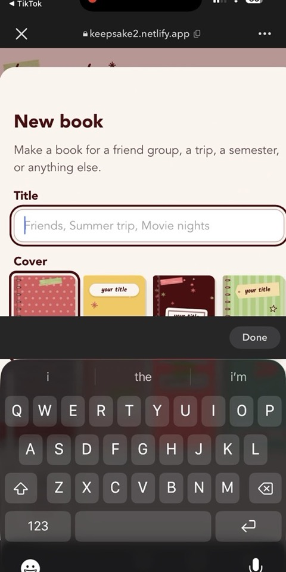
  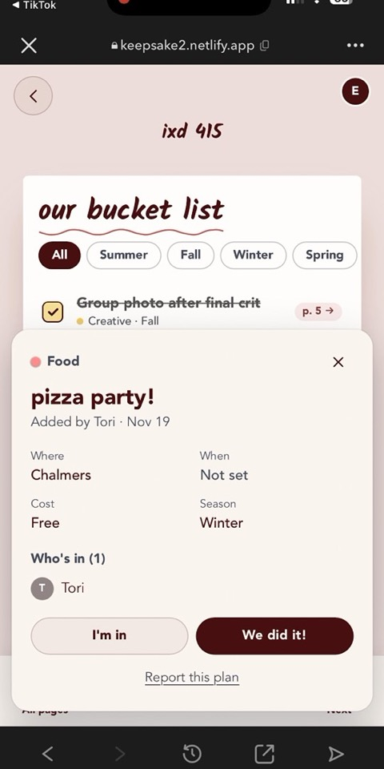
  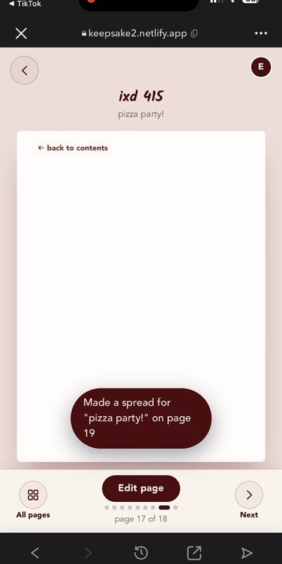
  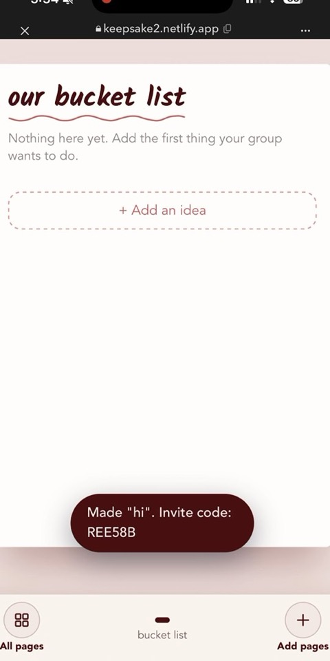
  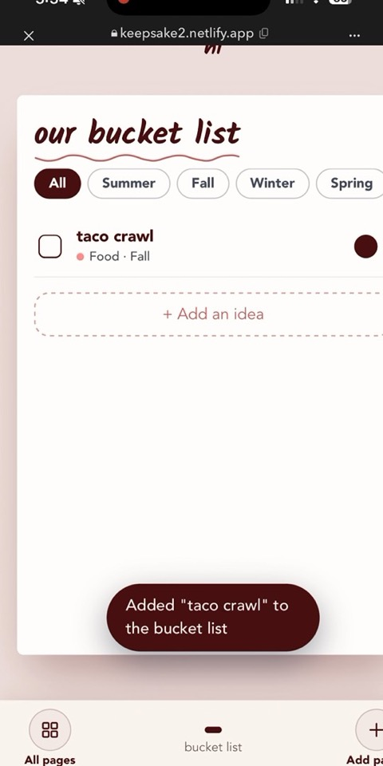

## Alyssa (11/23)

**What she said:** It took her a second to get familiar with everything since it was new, but once she started clicking through everything she liked it. She enjoyed the pictures and the run-through of each bucket list plan, with its location and cost.

**From the recording (4.3 min, Snapchat's in-app browser, the new phone layout that shows one page at a time):**
- Typed her name. Snapchat popped up its own "Autofill this form?" and "Save info?" sheets, like it did for Chris and Cami.
- Tapped **Join with a code** and joined with **IXD415** on the first try ("Joined IxD 415" showed).
- Tried the shelf's grid view, then opened the class book to the bucket list and tapped through the season filters. Spring said "Nothing for Spring yet."
- Opened almost every plan to read the details: Group photo after final crit (Studio, Finals week, Free), Coffee run between work sessions (Campus cafe, Any Wednesday, $, Matt and Maya in), End of quarter celebration, End of Yera Christmas Party and pizza party!. This matches what she said she enjoyed.
- Flipped through every page one at a time, from page 2 to page 18, and opened **All spreads** to see them all at once.
- Opened the **More** menu (Book settings, Leave book) and the member list ("26 people in IxD 415"). The list shows some names more than once, like Maya, Tori and Victoria, probably from testers joining more than once.
- She never tapped **Edit page**, **I'm in** or **+ Add an idea**. She spent the whole test reading and looking.

  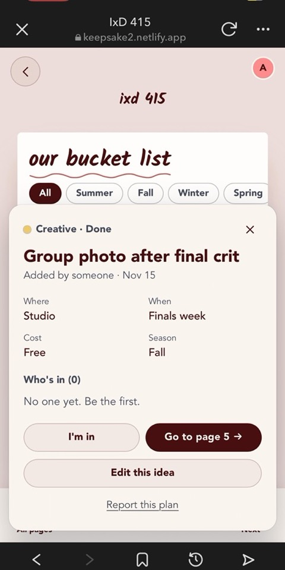
  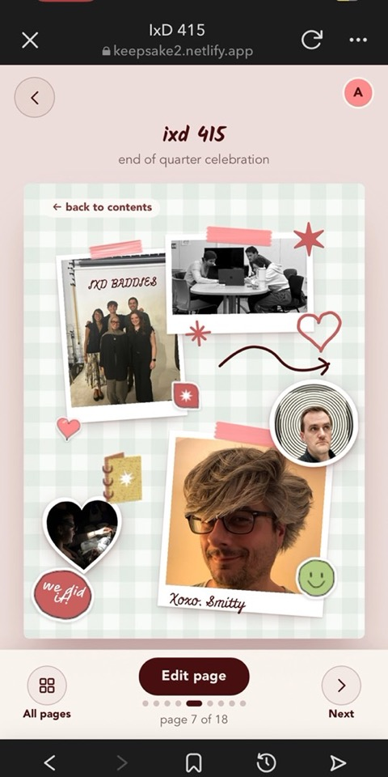
  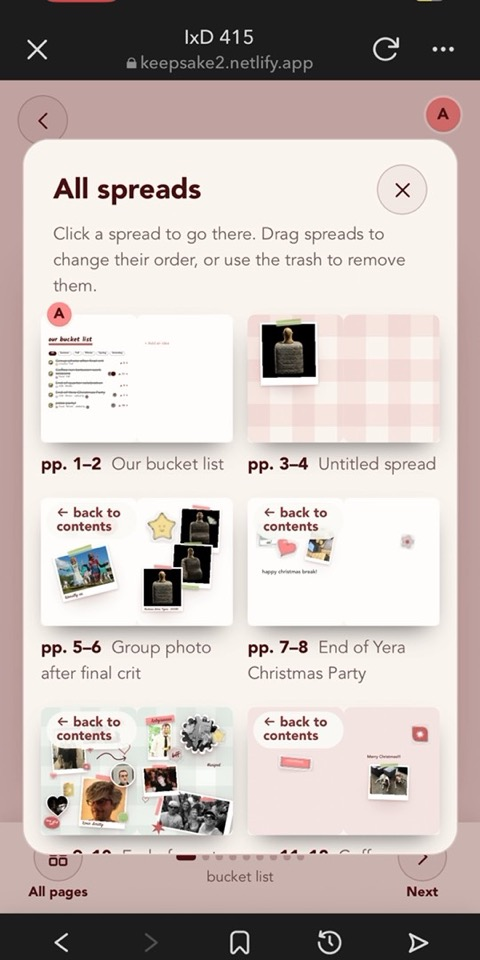
  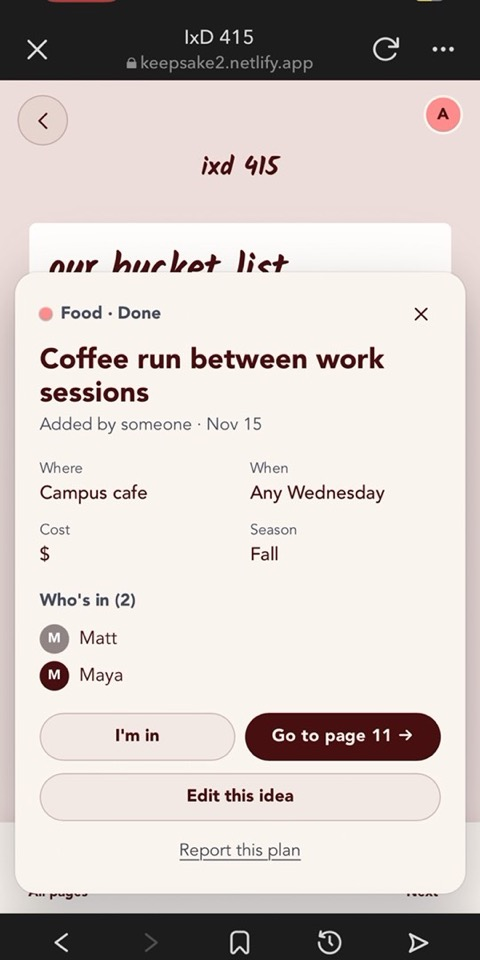
  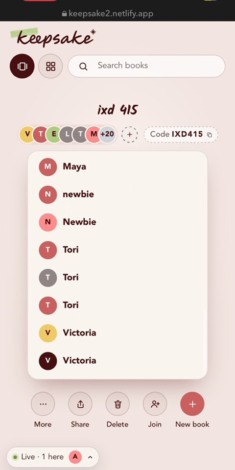

## Patterns so far

1. **Flipping through the book works.** All 10 got into the class book and flipped pages with no help. Mason called out the page flip.
2. **Save in the photo editor gets lost on phones.** Cancel and Save are at the very bottom and are easy to lose under Safari's toolbar, so cropping can't be saved.
3. **No next step after joining.** Mason and Chris never found **Edit**. Max found it but opened it 4 times without adding anything, which fits him not understanding it at first. Alyssa read every plan and page but never tapped **Edit page**.
4. **Joining a book is confusing at first.** Lily tried to add a book on her first try and couldn't, Max needed 3 tries to type the invite code, and Emmie opened **New book** before finding **Join with a code**. All three got in after that.
5. **Things are small on a phone.** Mason, Chris, Mom and Cami pinched to zoom in to read pages and the bucket list.
6. **Everyone liked the idea and the look.** All 10 said it was easy to use, fun, a cool concept, looking good, or self-explanatory, and Chris and Mason called out the look and the page flip.
7. **The guys looked around more than they made things.** Audrey jumped into editing and tried every photo option, Mom added a photo, sticker and note, Lily added a sticker, note and background, Cami added a caption, Emmie made her own book and bucket list idea, and Maya Zech knew right away that the point was to add to the book, while Mason, Chris and Max mostly looked around. Alyssa mostly looked around too, but she still said she enjoyed it. Keepsake will probably appeal more to girls, but testing with guys still showed where the app doesn't explain itself.
8. **Layouts don't say why they're off.** Once a page has anything on it, the layouts fade out, and the reason is hidden below them. Mom couldn't pick one and didn't know why. Lily saw the same faded layouts (the message was on screen for her) and moved on.
9. **Tabs don't switch while something is selected.** Mom tapped Text and Stickers with her photo selected and kept seeing the photo's settings. Lily tapped Layouts with her sticker selected and kept seeing the sticker's settings.
10. **It's too easy to delete or change something by accident.** Cami lost the Stormi photo while adding a caption next to it. Nothing asked her to confirm, and undo didn't bring it back. Emmie tapped **We did it!** on Tori's plan, which crossed it off and added a spread to the whole class book, also with no confirm.
11. **People want to share the bucket list.** Emmie asked for a way to share the bucket list by itself.
12. **The plan details are a highlight.** Alyssa opened almost every plan and said she enjoyed seeing each one's location and cost.

## Ideas to fix

- Keep **Cancel** and **Save** pinned to the top or bottom of the photo editor so they're always visible.
- Show the photo preview while cropping, or crop right on the preview.
- Make **Join with a code** the clear first step when someone opens Keepsake, so it's obvious how to get into a friend's book.
- After joining, show a short hint like "Tap Edit to add a photo to a page."
- Make page text and the bucket list bigger on phones.
- Put the "page already has things on it" message above the layouts, or let layouts work on a page that has things on it.
- Switching tabs should deselect the photo or sticker so the tab's tools show.
- Make undo bigger and easier to find, and make sure it brings back a deleted photo.
- Add a way to share the bucket list by itself, like a share button on the bucket list page.
- Ask "Are you sure?" before marking someone else's plan as done.
- Combine repeat names in the member list (Maya, Tori and Victoria each show up more than once).
- Ask "Are you sure?" before deleting a photo, and keep the delete button from landing on top of other things on the page.
