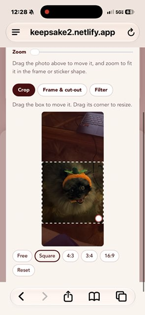

# 11/22 | Keepsake user testing (round 1)

4 of 10–15 testers so far · on their phones · screen recordings

Tested the [live Keepsake site](https://keepsake2.netlify.app/), joining the class book with the code **IXD415**.

## Screen recordings

- [Audrey (2.5 min)](audrey-keepsake-test-recording.mp4)
- [Mason (1 min)](mason-keepsake-test-recording.mp4)
- [Chris (1.3 min)](chris-keepsake-test-recording.mp4)
- [Max (1.5 min)](max-keepsake-test-recording.mp4)

Audrey's camera roll is blurred for the few seconds her phone's photo picker is open.

## Audrey

**What she said:** She really liked the idea and thought it was super easy to use. She got stuck in the photo cropping and couldn't save it, no matter what she tried.

**From the recording (2.5 min, Safari):**
- Flipped through the class book, tapped **Edit**, added a photo of her dog from her camera roll with **Browse**, and tapped **Done editing**. No trouble with any of it.
- Opened the photo editor and spent over a minute on **Crop**. She picked **Square** and kept dragging the crop box, but the photo preview sits above the crop area, so she couldn't see the result while cropping.
- **Cancel** and **Save** sit at the very bottom of the editor. Most of the time they were scrolled off screen or hidden behind Safari's toolbar. They only showed up for a second or two when she scrolled all the way down.
- She tried everything else in the editor: polaroid tape colors, Plain, all the filters, and the circle, heart, star and rounded cut-outs. She settled on the heart, then switched back to the polaroid with pink tape.
- The recording ends with the editor still open. **Save** was never tapped.
- Confirmed in Chris's recording: her dog photo is still on pages 11–12 as a plain, uncropped polaroid, so none of her edits were saved.

  
  
  

## Mason

**What he said:** He thought it was a cool concept but was confused about what he was supposed to do. The book with the pictures on it was awesome, and he liked how the pages flip like a real book.

**From the recording (1 min, in-app browser):**
- Typed his name and joined with **IXD415** with no trouble ("Joined IxD 415" showed).
- Flipped through every page from the bucket list to pages 13–14, where it ends at **Add pages**.
- Pinched to zoom in on a page to read it, which suggests the text and photos are small on a phone.
- Went back to the shelf, tapped the grid view ("Click a book to select it. Click again to open it."), then switched back to the shelf.
- Never tapped **Edit**, **New book** or anything that adds to the book. After joining, nothing tells you what to do next, which matches his confusion.

  
  

## Chris

**What he said:** His comments are coming soon.

**From the recording (1.3 min, Snapchat's in-app browser):**
- Typed his full name. Snapchat then popped up its own "Save info for next time?" sheet over the page.
- Joined with **IXD415**. For a moment the cover polaroid was blank while the photo loaded.
- Tapped the grid view, then the search bar by accident (the keyboard came up), then went back to the shelf.
- Opened the book and pinched to zoom in on the bucket list to read it. He tapped the season filters (Summer, Winter, Someday), and they worked. Someday was empty.
- Kept zooming in to look at the pages as he flipped through.
- Ended on pages 13–14 without tapping **Edit**, the same as Mason.

  
  

## Max

**What he said:** Fairly easy to use, but he didn't understand it at first.

**From the recording (1.5 min, Safari):**
- Typed his full name and joined, but the invite code took 3 tries: **IXS415** ("There's no book with that code. Check it and try again."), then **IXD414**, then **IXD415**. The error message helped him fix it.
- Flipped through the book and went back to the bucket list a few times.
- Unlike Mason and Chris, he found **Edit**. He opened the Edit spread panel on pages 5–6, 7–8, 11–12 and 15–16, then tapped **Done editing** each time without adding anything.
- Ended on the Edit spread panel for pages 15–16 without adding a photo, note or sticker.

  
  

## Patterns so far

1. **Flipping through the book works.** All 4 joined with the code and flipped pages with no help. Mason called out the page flip.
2. **Save in the photo editor gets lost on phones.** Cancel and Save are at the very bottom and are easy to lose under Safari's toolbar, so cropping can't be saved.
3. **No next step after joining.** Mason and Chris never found **Edit**. Max found it but opened it 4 times without adding anything, which fits him not understanding it at first.
4. **Things are small on a phone.** Mason and Chris pinched to zoom in to read pages and the bucket list.
5. **The guys were less into it than Audrey.** Audrey jumped into editing and tried every photo option, while Mason, Chris and Max mostly looked around. Keepsake will probably appeal more to girls, but testing with guys still showed where the app doesn't explain itself.

## Ideas to fix

- Keep **Cancel** and **Save** pinned to the top or bottom of the photo editor so they're always visible.
- Show the photo preview while cropping, or crop right on the preview.
- After joining, show a short hint like "Tap Edit to add a photo to a page."
- Make page text and the bucket list bigger on phones.
