# 11/22–11/23 | Keepsake user testing

7 of 10–15 testers so far · on their phones · screen recordings

Tested the [live Keepsake site](https://keepsake2.netlify.app/), joining the class book with the code **IXD415**.

## Screen recordings

- [Maya Zech (33 sec)](maya-zech-keepsake-test-recording.mp4)
- [Audrey (2.5 min)](audrey-keepsake-test-recording.mp4)
- [Mason (1 min)](mason-keepsake-test-recording.mp4)
- [Chris (1.3 min)](chris-keepsake-test-recording.mp4)
- [Max (1.5 min)](max-keepsake-test-recording.mp4)
- [Mom (3 min)](mom-keepsake-test-recording.mp4)
- [Lily (2 min, 11/23)](../2026-11-23/lily-keepsake-test-recording.mp4)

Audrey's and Mom's camera rolls are blurred for the few seconds their phone's photo picker is open.

## Maya Zech

**What she said:** It was very fun and easy to use, and it made sense right away that her task was to add to the scrapbook.

**From the recording (33 sec, Snapchat's in-app browser):**
- The recording starts with her already in the class book, so joining isn't shown.
- Flipped through the full photo collage spread, Audrey's dog photo (still uncropped), a face cut-out sticker, and the empty pages that say "nothing here yet" with **Add pages** at the end.
- Flipped back to the bucket list, went back to the shelf, opened the grid view, then reopened the book on the bucket list.
- Near the end the live bar changed from "1 here" to "2 here" as someone else joined the book.
- She didn't zoom in on anything, unlike Mason and Chris.
- She said her task was to add to the scrapbook, but adding isn't in this clip. It may have happened before or after the recording.

  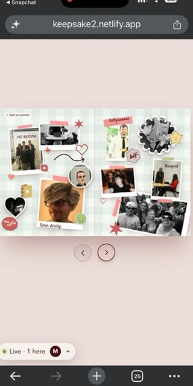
  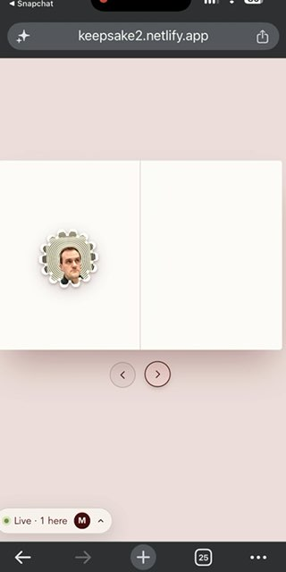

## Audrey

**What she said:** She really liked the idea and thought it was super easy to use. She got stuck in the photo cropping and couldn't save it, no matter what she tried.

**From the recording (2.5 min, Safari):**
- Flipped through the class book, tapped **Edit**, added a photo of her dog from her camera roll with **Browse**, and tapped **Done editing**. No trouble with any of it.
- Opened the photo editor and spent over a minute on **Crop**. She picked **Square** and kept dragging the crop box, but the photo preview sits above the crop area, so she couldn't see the result while cropping.
- **Cancel** and **Save** sit at the very bottom of the editor. Most of the time they were scrolled off screen or hidden behind Safari's toolbar. They only showed up for a second or two when she scrolled all the way down.
- She tried everything else in the editor: polaroid tape colors, Plain, all the filters, and the circle, heart, star and rounded cut-outs. She settled on the heart, then switched back to the polaroid with pink tape.
- The recording ends with the editor still open. **Save** was never tapped.
- Confirmed in Chris's recording: her dog photo is still on pages 11–12 as a plain, uncropped polaroid, so none of her edits were saved.

  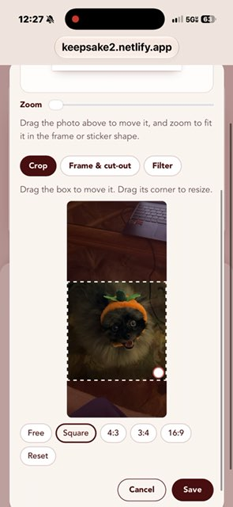
  
  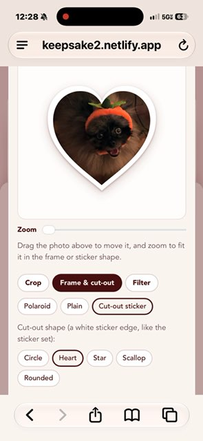

## Mason

**What he said:** He thought it was a cool concept but was confused about what he was supposed to do. The book with the pictures on it was awesome, and he liked how the pages flip like a real book.

**From the recording (1 min, in-app browser):**
- Typed his name and joined with **IXD415** with no trouble ("Joined IxD 415" showed).
- Flipped through every page from the bucket list to pages 13–14, where it ends at **Add pages**.
- Pinched to zoom in on a page to read it, which suggests the text and photos are small on a phone.
- Went back to the shelf, tapped the grid view ("Click a book to select it. Click again to open it."), then switched back to the shelf.
- Never tapped **Edit**, **New book** or anything that adds to the book. After joining, nothing tells you what to do next, which matches his confusion.

  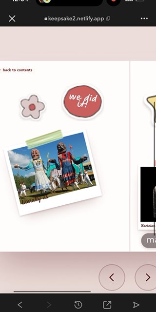
  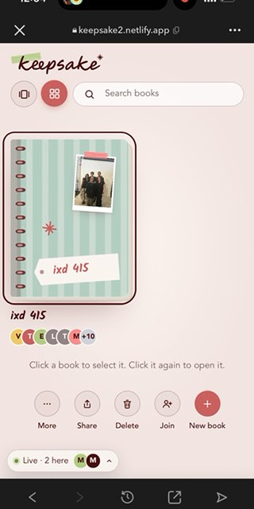

## Chris

**What he said:** It makes sense, and it was easy to use and update. He really liked the overall look and feel, and the idea.

**From the recording (1.3 min, Snapchat's in-app browser):**
- Typed his full name. Snapchat then popped up its own "Save info for next time?" sheet over the page.
- Joined with **IXD415**. For a moment the cover polaroid was blank while the photo loaded.
- Tapped the grid view, then the search bar by accident (the keyboard came up), then went back to the shelf.
- Opened the book and pinched to zoom in on the bucket list to read it. He tapped the season filters (Summer, Winter, Someday), and they worked. Someday was empty.
- Kept zooming in to look at the pages as he flipped through.
- Ended on pages 13–14 without tapping **Edit**, the same as Mason.

  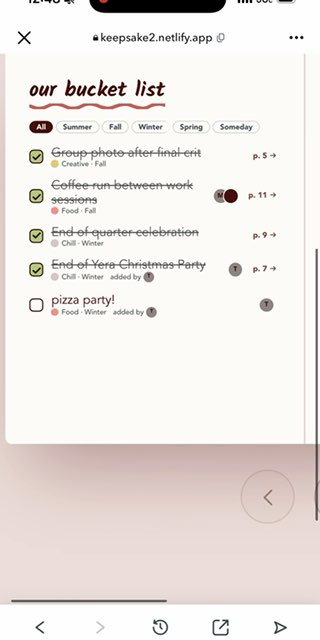
  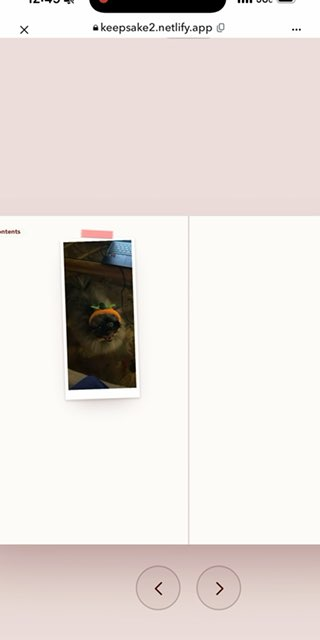

## Max

**What he said:** Fairly easy to use, but he didn't understand it at first.

**From the recording (1.5 min, Safari):**
- Typed his full name and joined, but the invite code took 3 tries: **IXS415** ("There's no book with that code. Check it and try again."), then **IXD414**, then **IXD415**. The error message helped him fix it.
- Flipped through the book and went back to the bucket list a few times.
- Unlike Mason and Chris, he found **Edit**. He opened the Edit spread panel on pages 5–6, 7–8, 11–12 and 15–16, then tapped **Done editing** each time without adding anything.
- Ended on the Edit spread panel for pages 15–16 without adding a photo, note or sticker.

  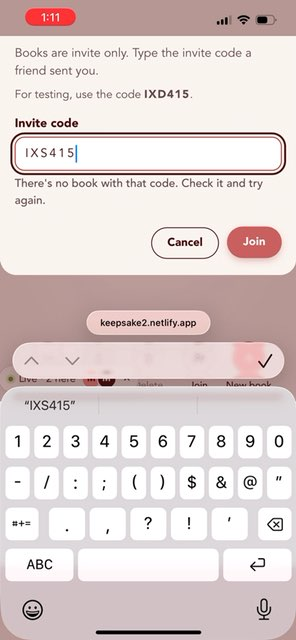
  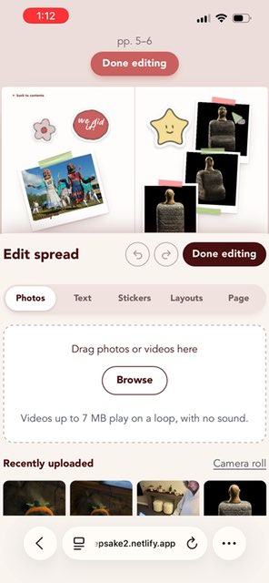

## Mom

**What she said:** She couldn't select a template, but it's a fun little app. She'd already added a photo, so she was confused why the layouts weren't working.

**From the recording (3 min, Chrome):**
- The recording starts with her already in the class book, so joining isn't shown.
- Flipped through to pages 11–12, tapped **Edit**, and added a photo of two dogs from her camera roll to the right page with **Browse**. No trouble.
- With the photo still selected, she tapped the **Text** and **Stickers** tabs, but the panel kept showing the photo's settings. The stickers only showed up after the photo was deselected.
- Added a red sticker and dragged it to the top corner of the page.
- Opened **Layouts** and switched between **Left page** and **Right page**, but the layouts were faded and tapping them did nothing. Both pages already had a photo on them, and layouts only work on a blank page. The message that says so ("The right page already has things on it. Layouts are for starting a blank page.") sits under the layouts, off screen, so she never saw why.
- Tapped **+ Add text box** and wrote "Merry Christmas!!!" above her dogs.
- Pinched to zoom in on the page a few times while editing, like Mason and Chris.
- Tapped **Done editing**. Her photo, sticker and note all stayed on the page.

  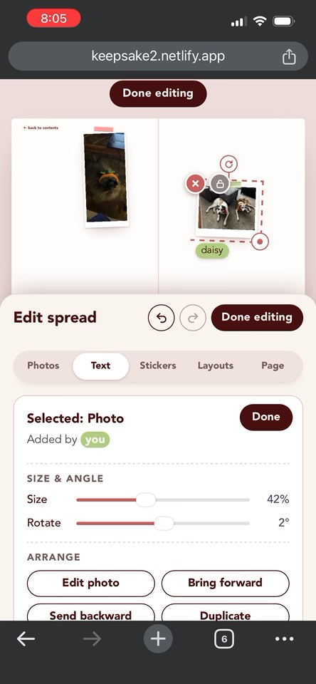
  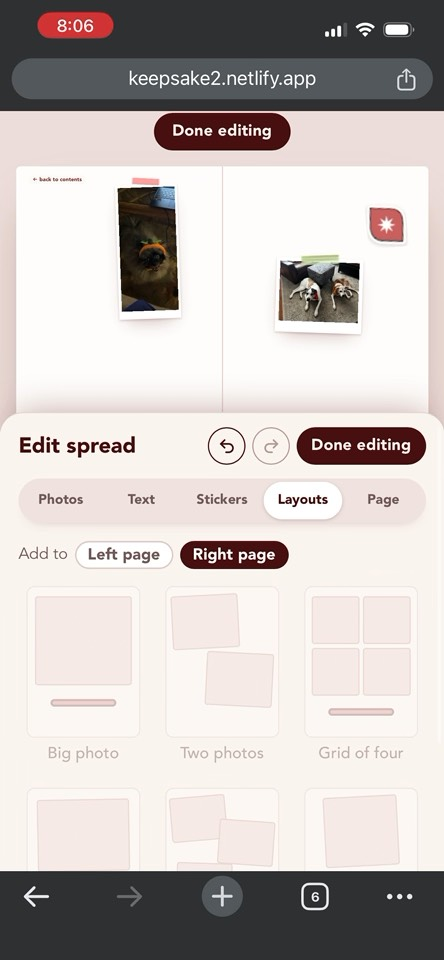
  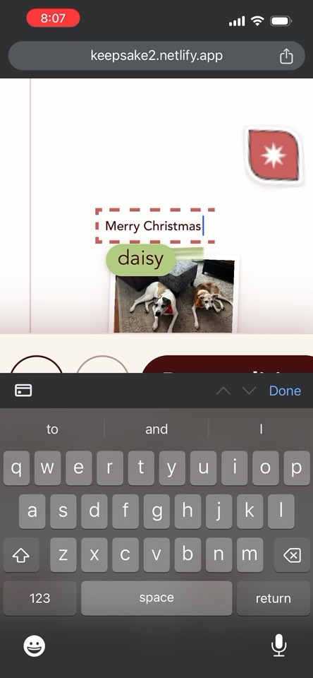
  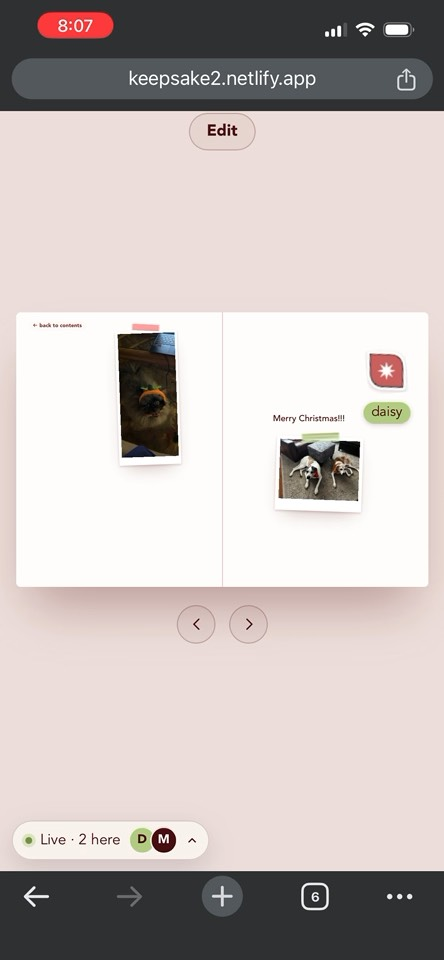

## Lily (11/23)

**What she said:** _Comments coming soon._

**From the recording (2 min, Safari private tab opened from Messages):**
- Typed her name and joined with **IXD415** on the first try ("Joined IxD 415" showed).
- Flipped from the bucket list through every spread to the blank pages 15–16, then tapped **Edit** right away. Unlike Mason and Chris, she found it on her own.
- Looked at **Photos**, then went to **Stickers** and added the smiley star. She made it bigger (22% to 47%) and looked at the tape and doodle stickers too.
- With the star still selected, she tapped **Layouts**, but the panel kept showing the sticker's settings, the same thing that happened to Mom. She tapped **Done editing** and **Edit** again to get out of it.
- On **Layouts**, every layout was faded because the left page had her star on it. This time the message ("The left page already has things on it. Layouts are for starting a blank page.") was on screen under the layouts. She didn't try the blank right page and moved on to **Page**.
- Tried the page backgrounds Paper, Rose and Butter, and picked Sage (green).
- Tapped **+ Add text box** and typed "HIIIIIIII". The keyboard covered most of the page while typing. Then she changed the font to Figma Hand and added the Rose label.
- Tapped **Done editing**. The star, note and green background all stayed. She ended in **All spreads**, where her page shows up as pp. 15–16.

  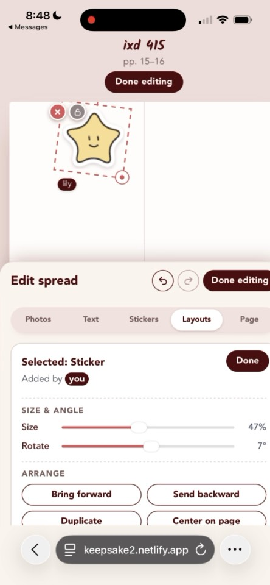
  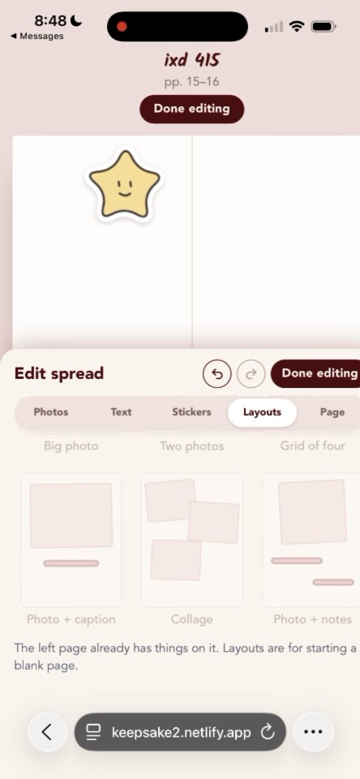
  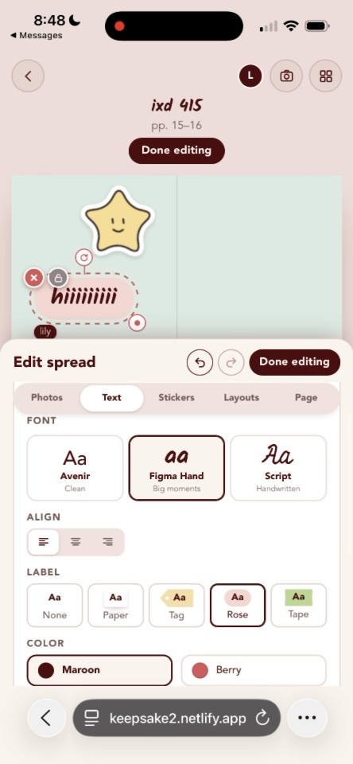
  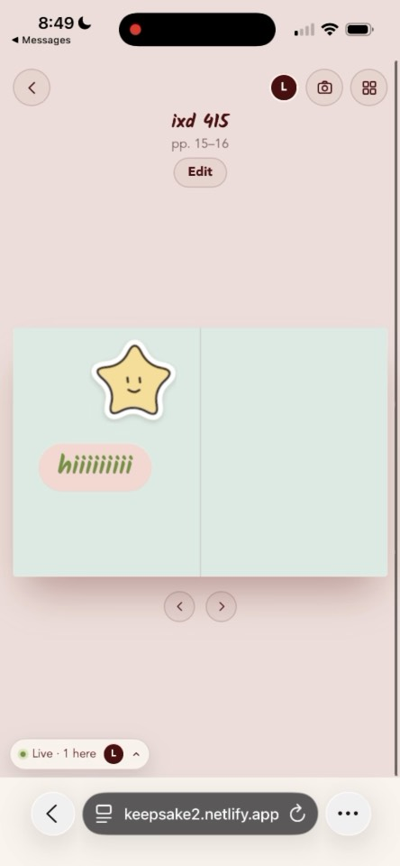
  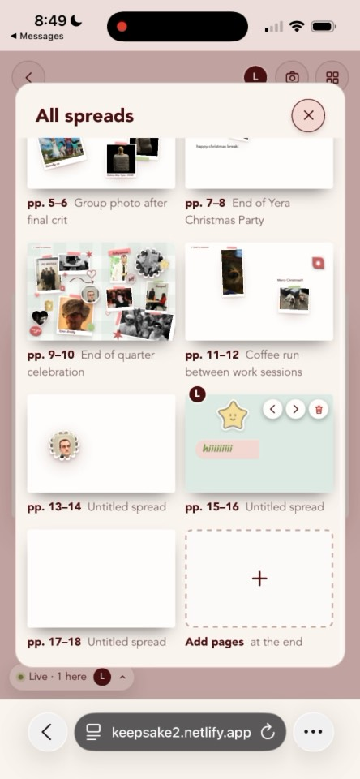

## Patterns so far

1. **Flipping through the book works.** All 7 got into the class book and flipped pages with no help. Mason called out the page flip.
2. **Save in the photo editor gets lost on phones.** Cancel and Save are at the very bottom and are easy to lose under Safari's toolbar, so cropping can't be saved.
3. **No next step after joining.** Mason and Chris never found **Edit**. Max found it but opened it 4 times without adding anything, which fits him not understanding it at first.
4. **Things are small on a phone.** Mason, Chris and Mom pinched to zoom in to read pages and the bucket list.
5. **Everyone liked the idea and the look.** All 6 said it was easy to use, fun, or a cool concept, and Chris and Mason called out the look and the page flip.
6. **The guys looked around more than they made things.** Audrey jumped into editing and tried every photo option, Mom added a photo, sticker and note, Lily added a sticker, note and background, and Maya Zech knew right away that the point was to add to the book, while Mason, Chris and Max mostly looked around. Keepsake will probably appeal more to girls, but testing with guys still showed where the app doesn't explain itself.
7. **Layouts don't say why they're off.** Once a page has anything on it, the layouts fade out, and the reason is hidden below them. Mom couldn't pick one and didn't know why. Lily saw the same faded layouts (the message was on screen for her) and moved on.
8. **Tabs don't switch while something is selected.** Mom tapped Text and Stickers with her photo selected and kept seeing the photo's settings. Lily tapped Layouts with her sticker selected and kept seeing the sticker's settings.

## Ideas to fix

- Keep **Cancel** and **Save** pinned to the top or bottom of the photo editor so they're always visible.
- Show the photo preview while cropping, or crop right on the preview.
- After joining, show a short hint like "Tap Edit to add a photo to a page."
- Make page text and the bucket list bigger on phones.
- Put the "page already has things on it" message above the layouts, or let layouts work on a page that has things on it.
- Switching tabs should deselect the photo or sticker so the tab's tools show.
