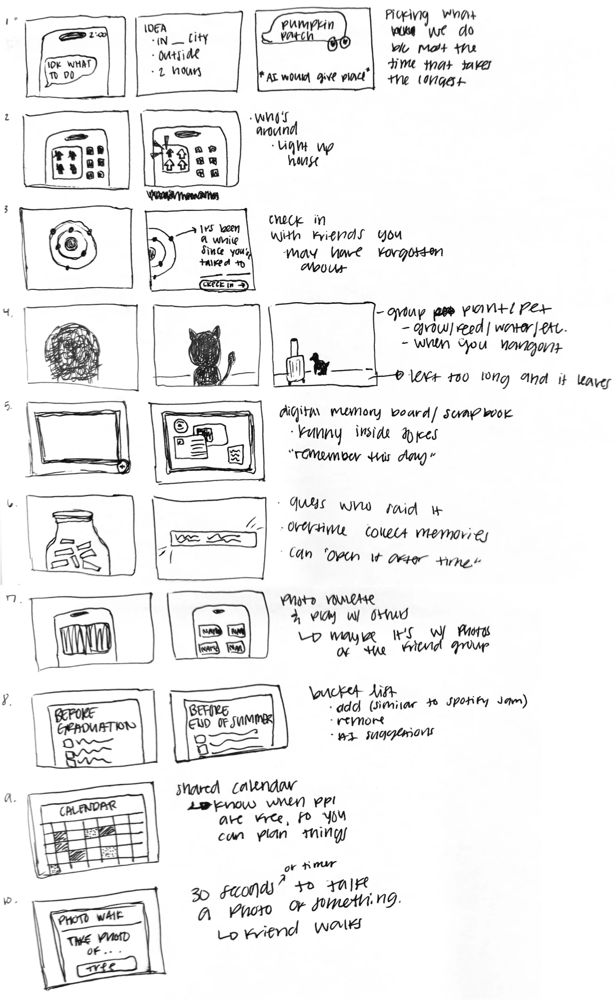

# 11/4 | Victoria's Sketches

10 storyboard ideas from class.

1. **Pick what we do:** someone says "idk what to do," enters a city, outside and 2 hours, and AI suggests a place like a pumpkin patch. Picking what to do usually takes the longest.
2. **Who's around:** a house lights up when a friend is around.
3. **Check in:** friends orbit around you, and the app reminds you when it's been a while since you talked to someone.
4. **Group plant or pet:** it grows when you hang out and you feed and water it, but if it's left too long, it leaves.
5. **Memory board:** a digital scrapbook of inside jokes and "remember this day" moments.
6. **Memory jar:** collect memories over time, guess who said it and open the jar later.
7. **Photo roulette:** play with others using photos of the friend group.
8. **Bucket list:** shared lists like "before graduation" or "before end of summer." Anyone can add or remove items, similar to Spotify Jam, with AI suggestions.
9. **Shared calendar:** see when people are free so you can plan things.
10. **Photo walk:** a 30-second timer to take a photo of something, like a tree, on friend walks.
