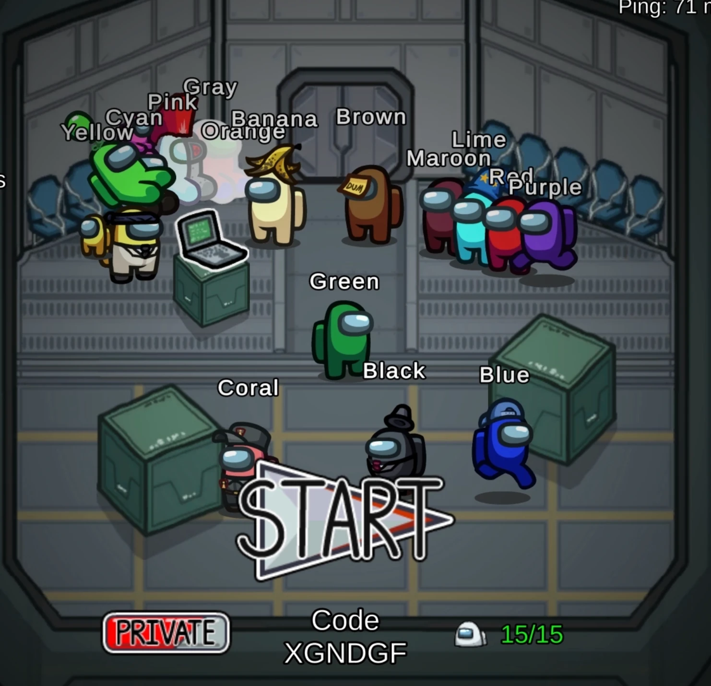
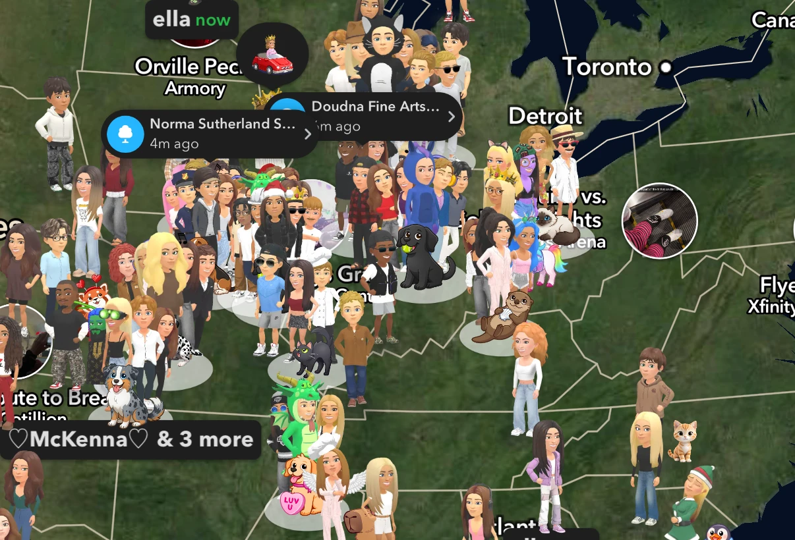
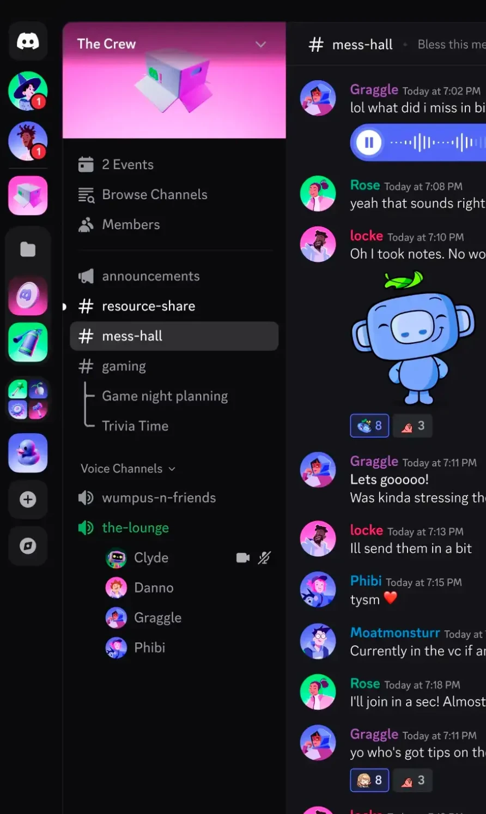

# Victoria | 3 different multiplayer things!

Write down what design choices told you other people were in there with you.

# 1. Among Us, a live social deduction game for a group of players
*Signals that others are here*
- Characters in a shared room. Everyone appears as a colored character with a name above their head, moving around the lobby in real time.
- Player count. "15/15" shows how full the lobby is before the game starts.
- Room code. A code at the bottom of the lobby is how friends get into the same game.

*Signals that others are watching*
- Line of sight. Other players can see you if you're nearby, which makes it feel risky to act suspicious.
- "I voted" badges. During meetings, a badge shows who has already voted.

# 2. Snapchat, a chat and map app for friends
*Signals that others are here*
- Snap Map. Friends' Bitmojis stand on a real map, so you can see where people are at a glance.
- Clusters. When friends are close together, their Bitmojis group up and a label shows a name "& 3 more".
- Bitmoji in chat. A friend's Bitmoji appears at the bottom of the chat while they're in it, and you can see when they're typing.

*Signals that others are watching*
- "Opened" shows that someone has seen your snap.
- Screenshot notices. You get told if someone takes a screenshot of your chat or snap.

# 3. Discord, voice and text chat for communities and friend groups
*Signals that others are here*
- Voice channel list. Names and avatars appear under a voice channel, so you can see who's in it before you join.
- Green channel icon. An active voice channel turns green, which stands out in the list.
- Camera and mute icons. Small icons next to a name show whether that person has their camera on or is muted.

*Signals that others are watching*
- Emoji reactions with counts. They show how many people responded to a message.
- Unread badges. Red numbers on server icons show that something happened while you were away.

