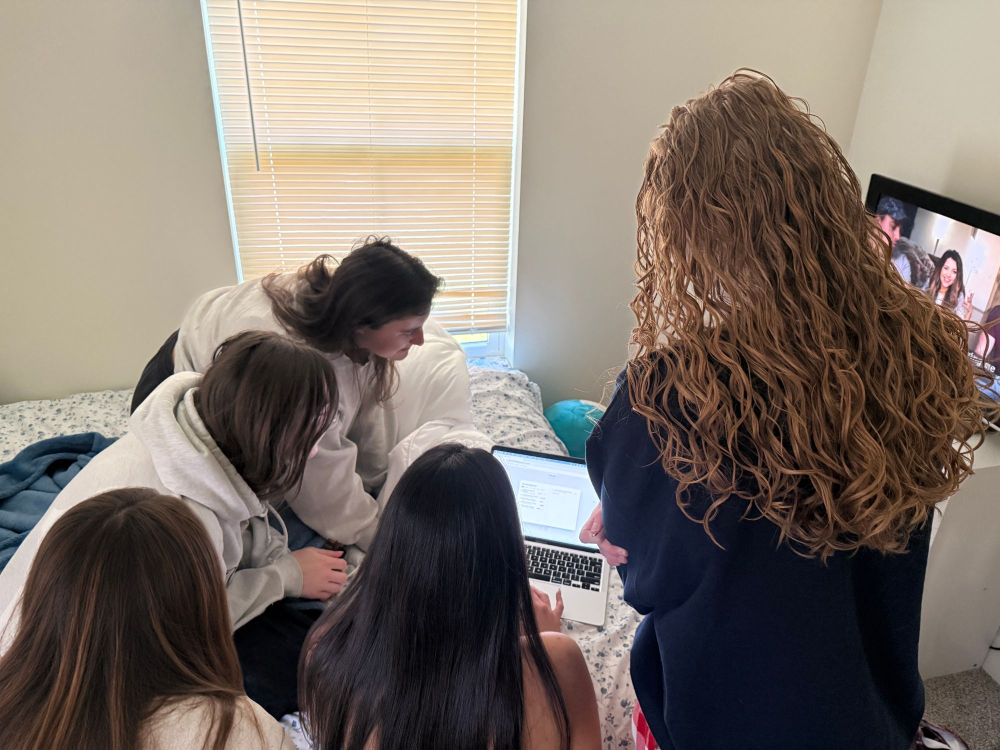

# 11/13 | Scrapbook user testing

Friday, November 13, 2026 · 5 participants · in person, on one shared laptop

Tested the [shared scrapbook prototype](../../../project/2026-11-13/).

## How it went

The prototype link wasn't live yet, so everyone gathered around one screen. I tested each person one at a time, then got everyone's thoughts as a group. They liked testing together and said it would be fun to use as a group.

## Findings

1. **Shared screen.** Since the link wasn't live, everyone had to be around the same laptop. It worked for one-on-one sessions plus group feedback, but people couldn't explore on their own devices.
2. **Groups and books aren't separated.** When you join, you're automatically added to all three books. It isn't clear how different groups and different books are kept apart.
3. **"Live here" isn't clickable.** Testers wanted to tap the "live here" indicator and see exactly who's there.
4. **The page flip jumps.** When you open the book and flip from the bucket list to the start of the book, the edit button pushes the book down, so the flip isn't smooth.

## Next steps

- Publish a live link for the next round, so people can test on their own phones.
- Let people choose which book or group to join, instead of adding them to all three automatically.
- Make "live here" open a list of who's currently there.
- Give the edit button a fixed spot so the book doesn't shift during the flip.
